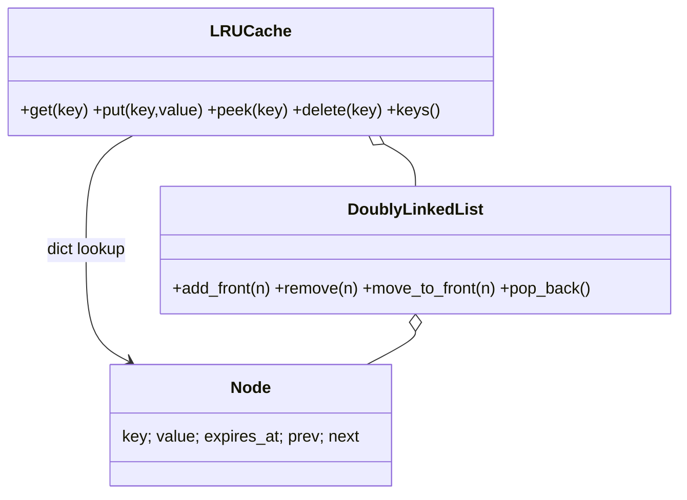

# LLD 01: LRU cache

The most-asked "small" LLD question. It looks like a data-structure puzzle but interviewers grade the design too: clean API, generic keys, edge cases, testability (injected clock), and whether you can explain *why* hash map + doubly linked list gives O(1). Budget: ~3 hours. Sketch first (30 min), linked list (45 min), cache (1h), TTL + callback + review (45 min).

## 1. Requirements: questions to ask the interviewer
- Fixed capacity by **item count** (not bytes)? What happens at capacity <= 0?
- What counts as "use"? (`get` and `put` both - yes; `peek`/`in` should not.)
- Must `get` and `put` be **O(1)**? (Yes - this forces the design.)
- Missing key: return `None`/default or raise? Can values be `None`?
- Do we need **TTL / expiry**? Is the TTL reset on read or on write?
- **Thread safety**? (Out of scope here; see follow-ups.)
- Do callers need to know about evictions (callback, metrics)?
- Single process, in memory only? (Yes. Redis/distributed is a follow-up.)

State assumptions out loud: count-based capacity, `get`/`put` refresh recency, None-able values, single-threaded, TTL optional.

## 2. Entities
| Entity | Responsibility |
|---|---|
| `Node` | Holds key, value, expiry, prev/next pointers. Stores the **key** too so eviction can delete the map entry. |
| `DoublyLinkedList` | Maintains recency order with sentinel head/tail; O(1) add/remove/move/pop. |
| `LRUCache` | Public API; owns `dict[key -> Node]` + the list; eviction policy; TTL; callback. |

## 3. Class diagram
```
 LRUCache
 +--------------------------+       +---------------------+
 | capacity, ttl, clock     |  has  | DoublyLinkedList    |
 | _map: dict[key, Node] ---+------>| head <-> ... <-> tail|
 | _list ------------------>|       | add_front/remove/   |
 | on_evict(key, value)     |       | move_to_front/      |
 | get/put/peek/delete/     |       | pop_back            |
 | keys/clear/len/in        |       +----------+----------+
 +--------------------------+                  | contains *
                                         +-----v-----+
                                         | Node      |
                                         | key,value |
                                         | expires_at|
                                         | prev,next |
                                         +-----------+

 head(sentinel) <-> MRU <-> ... <-> LRU <-> tail(sentinel)
```


## 4. Patterns used and why
- **Composition of two structures** (hash map for O(1) lookup, linked list for O(1) reorder/evict). Neither alone is O(1): a list can't find a key, a dict can't track order.
- **Sentinel (dummy) nodes**: no `if node.prev is None` branches; insert/remove are the same code at the ends.
- **Dependency injection (clock)**: TTL is testable without `sleep`. Same trick as the parking lot.
- **Observer-lite (`on_evict` callback)**: cache announces evictions without knowing who cares (write-back, metrics).
- **Strategy (follow-up)**: pull eviction policy behind an `EvictionPolicy` interface to support LFU/FIFO. Don't build it unless asked; mention it.
- **Encapsulation**: the list is a separate class so `LRUCache` has no pointer-juggling.

## 5. Extensibility follow-ups interviewers ask
- Make it thread-safe (coarse `Lock`; then lock striping/sharding; why `get` is a write).
- Add LFU / FIFO / random eviction (Strategy; LFU needs freq buckets, also O(1)).
- Per-entry TTL, background cleanup thread vs lazy expiry.
- Size-aware (weight) capacity: evict until total weight fits.
- Write-through / write-back with a backing store; cache stampede protection.
- Distributed cache: consistent hashing, replication (point to system design).
- Stats: hits, misses, evictions, hit ratio.
- Generic typing: `LRUCache[K, V]` with `typing.Generic`.

## 6. What to say out loud
1. "I'll use a dict from key to node plus a doubly linked list ordered by recency; the dict gives O(1) lookup and the list gives O(1) move-to-front and evict-from-back."
2. "Singly linked wouldn't work: removing an arbitrary node needs its predecessor. Doubly linked gives that in O(1)."
3. "Sentinel head and tail remove all the null checks."
4. "Node stores the key, because when I pop the tail I need to delete it from the dict."
5. "`get` mutates state - it's a write for locking purposes."
6. "I'm injecting the clock so TTL tests are deterministic."
7. Test plan: eviction order, get refreshes, update doesn't grow, capacity 1, delete, TTL boundary.

## 7. Common mistakes
- Using `OrderedDict` as the whole answer (fine as a footnote, wrong as the solution here).
- Forgetting to delete the map entry on eviction (memory leak, stale hits).
- Evicting **before** checking whether `put` is an update of an existing key (evicts a live entry needlessly).
- `if value:` / `if self._map.get(k):` checks that treat `0`/`None`/`""` as a miss.
- Breaking the order of pointer updates in `add_front` (set the new node's pointers first).
- `peek`/`in`/`keys` accidentally refreshing recency.
- Scanning for expired entries on every put (turns O(1) into O(n)).
- Not updating `size` consistently, or off-by-one on `>=` vs `>`.
- Using `time.time()` directly.

## 8. Follow-up Q&A
**Q: Why not just a list or `collections.deque`?** Finding/removing a middle item is O(n).
**Q: Why not a heap keyed by last-used time?** O(log n) per op, and updating a key's priority needs a lazy-deletion trick.
**Q: How do you make it thread-safe?** One lock around every public method (get too, since it reorders). If contention matters, shard by `hash(key) % N` with one lock + cache per shard; capacity is then per shard (approximate LRU).
**Q: How do you do TTL without a scan?** Lazy expiry on access (what we do) plus optionally a min-heap of `(expires_at, key)` or a timer wheel for proactive cleanup. Full scan on `len` is O(n) by design here.
**Q: LFU in O(1)?** dict key->node, dict freq->doubly linked list of nodes, track `min_freq`; on access move node from freq f to f+1.
**Q: What does `functools.lru_cache` do differently?** It's the same structure in C, but is function-memoization-only (keys from args), no TTL/delete/callback.
**Q: What are the memory implications?** Each entry = dict slot + Node object (use `__slots__` to shrink it).
**Q: Hit ratio is bad; why?** Scan-resistant policies (2Q, ARC, TinyLFU) beat pure LRU when one-off scans flush the hot set.

## Your task
Fill in `exercises.py`, then run
`.venv/bin/pytest 11-lld/problem-01-lru-cache -v`

Then, out loud and on paper (10 min): re-derive the pointer updates of `add_front` and `remove` without looking.
