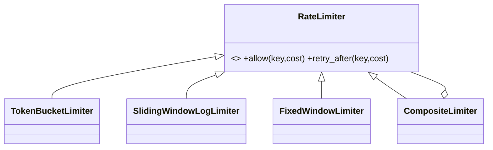

# LLD 02: Rate limiter

Classic at Google/Uber/Stripe-style interviews. The trap: candidates pick one algorithm and hard-code it. The strong answer defines a `RateLimiter` interface, implements two or three algorithms behind it, injects the clock, and discusses concurrency and memory. Budget: ~4 hours. Sketch + trade-offs (45 min), token bucket (1h), sliding window (1h), fixed window + composite (45 min), concurrency review (30 min).

## 1. Requirements: questions to ask the interviewer
- Who is limited: user, API key, IP, endpoint, or a combination? (-> a `key` string.)
- Limit shape: steady rate, **bursts allowed**, or hard N per window?
- Hard (reject) or soft (queue/delay)? What does the caller get back - bool, or also "retry after"?
- Single process or distributed? (Here: in-process; distributed is a follow-up.)
- Multiple limits at once (10/sec **and** 1000/hour)? Different limits per tier/plan?
- Accuracy vs memory: is a 2x boundary burst acceptable?
- Is a request ever "heavier" than 1 (cost/weight)?
- Concurrency: many threads hitting the same key?

Assumptions to state: in-memory, reject (return False), per-key state, integer cost, thread-safe, time source injectable.

## 2. Entities
| Entity | Responsibility |
|---|---|
| `RateLimiter` (ABC) | Contract: `allow(key, cost)`, `retry_after(key, cost)`. |
| `TokenBucketLimiter` | Burst-friendly; per key `(tokens, last_refill)`; lazy refill. |
| `SlidingWindowLogLimiter` | Exact; per key deque of timestamps. |
| `FixedWindowLimiter` | Cheapest; per key `(window_start, count)`. |
| `CompositeLimiter` | AND of several limiters with no partial charge (Composite pattern). |
| clock | Injected callable; makes everything deterministic. |

## 3. Class diagram
```
            +---------------------------+
            |  <<ABC>> RateLimiter      |
            |  allow(key, cost) -> bool |
            |  retry_after(key, cost)   |
            +-------------+-------------+
     +------------+-------+-----------+----------------+
     |            |                   |                |
TokenBucket   SlidingWindowLog   FixedWindow      CompositeLimiter
(tokens,last) (deque[ts])        (start,count)    has-many RateLimiter
 per key       per key            per key         (is-a RateLimiter)
 + Lock        + Lock             + Lock          + Lock
 + clock()     + clock()          + clock()
```


## 4. Algorithms and trade-offs
| | Token bucket | Sliding window log | Fixed window |
|---|---|---|---|
| Memory / key | O(1) | O(limit) | O(1) |
| Burst | up to capacity, then steady rate | none beyond limit | up to **2x limit** at the boundary |
| Accuracy | good | exact | coarse |
| Use | APIs allowing bursts (most common) | strict quotas, low limits | cheap/coarse, counters in Redis |

Token bucket math: `tokens = min(capacity, tokens + elapsed*rate)`; no timer threads - refill is **lazy**, computed on access. Sliding window *counter* (weighted two fixed windows) is the O(1)-memory approximation of the log; mention it.

## 5. Patterns used and why
- **Strategy**: callers depend on `RateLimiter`; algorithm is swappable (OCP).
- **Composite**: `CompositeLimiter` is itself a `RateLimiter`, so limits stack without callers changing.
- **Dependency injection**: the clock (testability, no sleeps).
- **Template of validation**: shared `cost` checks in one place.
- **Monitor/lock**: each limiter guards its state with its own lock (check-then-act must be atomic).
- (Follow-up) **Factory/Registry** to map plan/endpoint -> limiter config; **Decorator/middleware** to apply it.

## 6. Extensibility follow-ups interviewers ask
- Distributed limiting: Redis + Lua script (atomic), sticky sharding by key, or approximate local counters synced periodically.
- Per-tier limits (free vs paid) - registry keyed by plan.
- Return rich result (remaining, reset time, `Retry-After` header, `X-RateLimit-*`).
- Blocking/queueing variant (leaky bucket as a queue).
- Eviction of idle keys (memory leak!): TTL map / LRU of limiters (ties to problem 01).
- Dynamic config reload without losing state.
- Metrics, shadow mode (log would-be rejects).
- Fail-open vs fail-closed when the limiter store is down.

## 7. What to say out loud
1. "I'll expose `allow(key, cost)` returning bool plus `retry_after` so callers can emit a 429 with `Retry-After`."
2. "Token bucket for burst-tolerant APIs; sliding window log when exactness matters; fixed window is cheapest but allows a 2x burst at the boundary."
3. "No background refill thread: I compute refill lazily from elapsed time on each call."
4. "Check-and-decrement must be atomic, so a lock per limiter (or per key if contention shows up)."
5. "Denied requests must not consume budget - otherwise retries starve the client."
6. "Clock is injected and I guard against it going backwards; production would use a monotonic clock, not wall time."
7. "State is per key, so memory grows with key cardinality - I'd evict idle keys."

## 8. Common mistakes
- Using `time.time()`/`sleep` directly (untestable, also wall clocks jump).
- Refilling with a timer thread instead of lazily.
- Not capping tokens at capacity (hours of idle -> unlimited burst).
- Charging on denial; or in a composite, charging limiter A then failing on B (partial consumption).
- Race: `if tokens >= cost: ...; tokens -= cost` without a lock.
- Off-by-one at the window boundary (decide if an entry at `t0` counts at `t0+window`; document it).
- Never pruning the log; never evicting idle keys.
- Float drift: compare fractional tokens carefully; use exact test numbers.
- Creating a `Lock` per call instead of per limiter.

## 9. Follow-up Q&A
**Q: Token bucket vs leaky bucket?** Token bucket allows bursts and meters at request time; leaky bucket smooths output to a constant rate (a queue).
**Q: How do you make it work across 50 servers?** Shared store (Redis) with an atomic Lua script for refill+decrement, or route by key hash to one owner. Accept approximation if cheap local limits + periodic sync is OK.
**Q: Where do you place it?** API gateway/middleware before business logic; also per-dependency client-side limits.
**Q: Lock contention on a hot key?** Per-key locks/striping; or atomic ops; or split the budget across shards and rebalance.
**Q: How to avoid unbounded memory?** Evict keys idle for > window (token bucket: idle long enough = full bucket = equivalent to a missing key, so dropping it is lossless).
**Q: What do you return to the client?** HTTP 429 + `Retry-After` (from `retry_after`) + remaining/reset headers.
**Q: Fixed window's 2x burst - how to fix cheaply?** Sliding window counter: `prev_count * overlap_fraction + curr_count`.
**Q: How do you test time-based code?** Inject a fake clock that tests advance explicitly; concurrency tests freeze the clock so counts are exact.

## Your task
Fill in `exercises.py`, then run
`.venv/bin/pytest 11-lld/problem-02-rate-limiter -v`

Then on paper: write the token bucket for a distributed setting as pseudo-Lua (read tokens/ts, refill, decrement, write).
