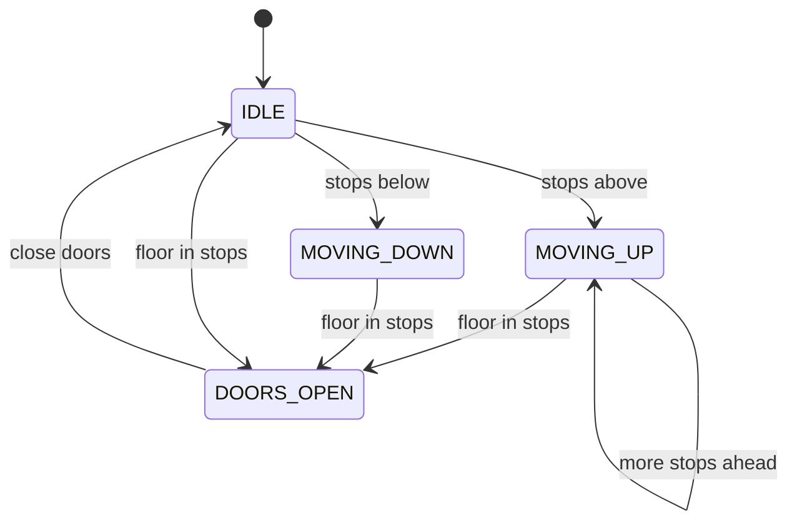

# Problem 03: Elevator system

A top-5 LLD question. The trap is jumping to classes; the real content is the state machine, the stop-ordering rule and the pluggable dispatch policy. Budget: ~3-4 hours (read + sketch 45m, `Elevator` 1.5h, strategies + controller 1h, review 45m). Interview budget: 35-45 minutes.

## 1. Requirements: questions to ask
- How many elevators and floors? One building, or zones? (Assume: N cars, one building, floors 0..F-1.)
- Two kinds of input: **hall calls** (floor + up/down button) and **cabin requests** (floor button inside). Both needed?
- Capacity / weight limits? Door timing? Emergency stop? (Assume: out of scope, but name them.)
- Objective: minimise average wait, or worst-case wait, or energy? (Drives the scheduling strategy.)
- Real time or simulation? (Assume a discrete `step()`; it makes the design deterministic and testable.)
- Should a car pick up passengers heading the same way on the way (LOOK/SCAN), or serve FIFO?
- Concurrency: are requests arriving from multiple threads? (Mention a lock around the controller; don't build it.)

## 2. Entities
| Entity | Responsibility |
|---|---|
| `Direction`, `ElevatorState` | Enums. Direction is the *intent*, state is what the car is doing right now (idle / moving / doors open). |
| `Elevator` | One car: floor, direction, pending stops, and the `step()` state machine. Knows nothing about other cars. |
| `SchedulingStrategy` | Policy: given all cars and a hall call, which car? |
| `ElevatorController` | Facade. Receives hall calls / cabin buttons, delegates to strategy, drives the simulation clock. |

## 3. Class diagram
```
            +-----------------------+        1   *  +---------------------+
 caller --> |  ElevatorController   |<>------------->|      Elevator       |
            |  strategy             |                |  floor, direction   |
            |  request_pickup()     |                |  state, stops       |
            |  select_floor()       |                |  add_stop() step()  |
            |  step()               |                +---------------------+
            +-----------+-----------+
                        | uses (injected)
                        v
              <<abstract>> SchedulingStrategy
                 select(elevators, floor, direction)
                 ^                       ^
                 |                       |
     NearestElevatorStrategy    LeastLoadedStrategy
```


## 4. Patterns and why
- **Strategy** (`SchedulingStrategy`): dispatch policy changes constantly (nearest, least loaded, zoned, destination dispatch). The controller must not change when it does (OCP, DIP).
- **State machine** (explicit `ElevatorState` + one `step()`): every transition is in one place; no hidden booleans like `is_moving and not door_open`. If states grow behaviours (maintenance, fire mode), promote each to a State class exactly as in problem 04.
- **Facade** (`ElevatorController`): callers never touch cars directly.
- **LOOK algorithm** inside `Elevator`: serve all stops in the current direction, reverse only when nothing is ahead. It avoids zig-zagging and starvation and is what real elevators do. Say its name.

## 5. Spec summary
Read the docstrings in `exercises.py`; they are the contract. Key rules:
- `step()` does ONE action: close doors, else open doors if on a stop, else go idle if no stops, else move one floor by the LOOK rule.
- Idle car heads for the nearest stop; ties go to the lower floor.
- `NearestElevatorStrategy`: eligible = no stops, or already moving the requested way and not yet past the floor; min by `(distance, id)`; fall back to all cars.
- Invalid floors raise `InvalidFloorError`, unknown cars `UnknownElevatorError`.

## 6. Extensibility follow-ups interviewers ask
- **Capacity / overload**: add `load` and `capacity` to `Elevator`; strategy skips full cars; cabin overload blocks door close.
- **Express / zoned elevators**: a strategy that filters by zone; or `Elevator.served_floors`.
- **Destination dispatch** (Otis style): passengers enter the destination at the hall; new method on controller, strategy groups riders with similar destinations.
- **Priority** (fire, VIP): stop set becomes a priority queue; a `FireMode` state that ignores calls and returns to ground.
- **Concurrency**: requests arrive on many threads while a single ticker thread calls `step()`. One `Lock` in the controller (or a thread-safe queue of commands drained by the ticker) is enough; don't lock per elevator unless cars run on separate threads.
- **Observers**: floor-display panel / logging subscribe to elevator events (Observer, see problem 07).
- **Real time**: replace tick with timestamps and travel/door durations; inject a clock.

## 7. What to say out loud
1. "I'll clarify scope: hall calls plus cabin buttons, N cars, simulation with a discrete step, capacity out of scope."
2. "Core entities are Elevator, Controller, and a Strategy for dispatch. I'll model the car as an explicit state machine."
3. "For stop ordering I'll use LOOK: finish the current direction, then reverse. Here is why not FIFO: a car would ping-pong."
4. "Dispatch is a Strategy so we can swap policies; I'll implement nearest-eligible first and mention least-loaded."
5. "Ties are broken deterministically (lower floor, lower id) so behaviour is testable."
6. "Time complexity: add_stop O(log n) amortised with a sorted list or O(1) with a set; step is O(n) in stops for direction choice, can be improved with two heaps."

## 8. Common mistakes
- No explicit states: booleans `moving`, `door_open` that can contradict each other.
- A single FIFO queue of requests, so the car ping-pongs 1 -> 20 -> 2 -> 19.
- Putting scheduling `if/elif` chains in the controller instead of a Strategy.
- Moving several floors or sleeping inside `step()` (untestable). One action per tick.
- Ignoring the requested direction in hall calls: sending an UP-bound car that is already moving DOWN past you.
- Mutable shared state returned from properties (`stops` must be a copy).
- Forgetting validation: floor -1 or floor >= N must fail without changing state.

## 9. Follow-up Q&A
**Q: Why a stop *set* instead of a queue?** Pressing the same floor twice, or two riders going to 7, is one stop. Order comes from the LOOK rule, not insertion order.

**Q: How would you stop starvation under LOOK?** LOOK always reverses when nothing is ahead, so every stop is served within two sweeps. Pure nearest-first would starve far floors; that's why eligibility prefers direction-aligned cars.

**Q: Hall call direction matters? The car stops regardless here.** Correct, in this simplification the stop is added on pickup floor. A fuller model records `(floor, direction)` and only opens for riders going the same way, or tracks pending hall calls separately from cabin stops.

**Q: How do you test this without time?** `step()` is the clock. Tests call it N times and assert floor/state; strategies are tested as pure functions of elevator snapshots.

**Q: Two cars equally close?** Deterministic tie-break on id; otherwise flaky tests and unfair wear.

**Q: Where does thread safety go?** Controller owns the lock (or a command queue). Strategy reads car state, so selection and `add_stop` must be one critical section, otherwise two threads can pick the same "idle" car.

**Q: How would you swap to destination dispatch?** New controller method plus a strategy that receives (origin, destination); cars hold per-rider destinations. The Elevator state machine is unchanged, which is the point of the separation.

**Q: Is LOOK the same as SCAN?** SCAN always travels to the end of the building before reversing; LOOK reverses at the last request. LOOK wastes less travel.

## Your task
Fill in `exercises.py`, then run
`.venv/bin/pytest 11-lld/problem-03-elevator-system -v`
Then re-explain, out loud and without notes, why `step()` returns after each branch.
