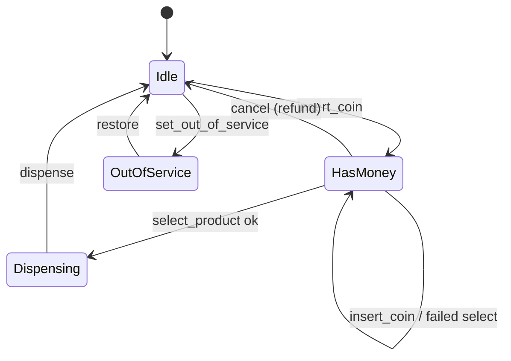

# Problem 04: Vending machine (State pattern)

The textbook State-pattern problem. Interviewers want to see that you replace `if state == ...` ladders with polymorphism, and that money handling is correct (atomic sales, exact change). Budget: ~3 hours (sketch 30m, inventory 30m, states 1.5h, change-making + review 1h). Interview budget: 35-45 minutes.

## 1. Requirements: questions to ask
- What can the user do? (insert coins, select a slot, cancel for refund, collect product.)
- Cash only, or cards / mobile? (Assume cash, denominations as an enum; payment is an extension point.)
- Does the machine give change? From what float? What if it cannot? (Assume yes, from its own stock plus the coins just inserted; if it cannot, the sale is refused, nothing changes.)
- Slot model: one product per slot code with a quantity? Can prices differ per slot?
- Maintenance / out-of-service mode? Restocking? Who refills coins?
- Does an inserted coin ever get rejected (bad coin)? Timeouts that auto-refund?
- Concurrency: one user at a time (physical machine). Mention a lock if there is a remote/IoT interface.

## 2. Entities
| Entity | Responsibility |
|---|---|
| `Coin` | Enum with value in cents. Money as `int` cents, never floats. |
| `Product` | Immutable name + price. |
| `Inventory` | Slot code -> (product, quantity). Knows nothing about money. |
| `State` + 4 concrete states | Behaviour for each event in each situation. |
| `VendingMachine` | Context: owns balance, coin stock, inventory, current state; delegates events to the state. |
| `DispenseResult` | What the user physically receives. |

## 3. Class diagram
```
 VendingMachine ------------------------> Inventory
   state: State  (delegates events)         slots: code -> (Product, qty)
   balance, coin_stock
   insert_coin / select_product
   dispense / cancel
          |
          v
   <<abstract>> State
   insert_coin(m, coin)   select_product(m, code)
   dispense(m)            cancel(m)
     ^        ^            ^             ^
     |        |            |             |
 IdleState HasMoneyState DispensingState OutOfServiceState
```


## 4. Patterns and why
- **State**: four events x four situations. Without it every method is an `if self.state == ...` ladder, and adding a state (Maintenance, CardPayment) edits every method (OCP violation). With it, a new state is a new class; illegal events are explicit (`InvalidOperationError`) instead of silently ignored.
- **Context/delegation**: `VendingMachine` keeps data and forwards events, so states stay stateless and can even be shared singletons.
- **Dependency inversion for the inventory**: the machine takes an `Inventory` object, so you can test with a fake and later back it with a database.
- Possible extra: **Strategy** for change-making (greedy vs DP) and for payment (cash/card).

## 5. Spec summary
Read the docstrings in `exercises.py`; they are the contract. Key rules:
- `select_product` validates in a fixed order (unknown, sold out, insufficient funds, cannot make change) and a failure changes **nothing** (atomicity).
- On success the money moves into the coin stock, the change leaves it, the inventory decrements, balance becomes 0, state becomes `dispensing`; `dispense()` hands over `DispenseResult` and returns to idle.
- `cancel()` refunds the exact coins inserted, largest first, so a refund can never fail.
- Greedy change with limited stock; coins available = stock + coins inserted this transaction.

## 6. Extensibility follow-ups interviewers ask
- **Card / mobile payment**: introduce a `PaymentMethod` abstraction; the machine no longer cares whether balance came from coins. HasMoney becomes "HasCredit".
- **Optimal change-making**: swap greedy for DP over limited coin counts (see Q&A).
- **Restocking and cash collection**: admin API on inventory/coin stock, guarded by an `Admin` role or a Maintenance state.
- **Timeouts**: HasMoney with a deadline and injected clock; auto-cancel after N seconds.
- **Combos / discounts**: pricing strategy between product price and charged amount.
- **Telemetry**: observers for low stock, jammed dispenser (see problem 07).
- **Multiple machines**: a fleet service reading each machine's inventory; machine stays single-user, no locking inside.

## 7. What to say out loud
1. "Cash vending machine: insert coins, select a slot, collect product plus change, or cancel. I'll keep money as int cents."
2. "The behaviour depends on what situation the machine is in, so this is a State pattern: Idle, HasMoney, Dispensing, OutOfService."
3. "The machine is the context and delegates each event; illegal events raise a specific error."
4. "A sale is atomic: I validate everything first and only then mutate stock, inventory and balance."
5. "Change comes from the stock plus the coins just inserted; if I can't make exact change I refuse and keep the user's money intact."
6. "Greedy change-making is correct for canonical coin systems with unlimited coins; with limited stock it can fail where DP would succeed. I'd note that and switch if asked."

## 8. Common mistakes
- Floats for money.
- `if/elif` on a string or enum state in every method instead of polymorphism.
- Mutating inventory or stock **before** discovering change can't be made, so a failed sale leaks product or coins.
- Forgetting that the inserted coins can be used as change (rejecting sales that are perfectly possible).
- States holding data: the sale details belong to the machine (context), so states are reusable.
- Letting `cancel` do change-making that can fail. Refund the physical coins.
- Not covering all events in all states (what does `dispense` do while idle?).

## 9. Follow-up Q&A
**Q: Why State instead of an enum and a switch?** Each state's behaviour is one class; adding or changing a state doesn't touch the others (OCP), and the compiler/ABC forces you to answer "what does event X do here?".

**Q: Who triggers transitions: the machine or the states?** Both approaches exist. Here states trigger them (`machine._set_state(...)`), keeping the transition table next to the behaviour. If transitions get complex, a table-driven machine is an alternative.

**Q: When does greedy change-making fail?** Stock {QUARTER:1, DIME:3}, change 30: greedy takes the quarter and is stuck at 5; DP finds 3 dimes. Greedy is also wrong for non-canonical systems (coins 1, 3, 4 and amount 6).

**Q: How would you do DP change-making?** Bounded coin-change: `dp[amount] = fewest coins` over denominations with counts, O(amount/gcd x denominations x counts). Amounts are tiny, so cost is irrelevant; put it behind a `ChangeStrategy`.

**Q: Should states be singletons?** If they hold no data, yes or at least cheap to share (Flyweight). Mention it, don't over-engineer.

**Q: Thread safety?** A physical machine has one user, but with a remote API, a single lock around each event keeps the check-then-mutate in `select_product` atomic.

**Q: What if the dispenser jams after we took payment?** Add a `Dispensing -> Fault` transition that refunds, plus logging/alerts. The State pattern makes that a new class, not a rewrite.

**Q: Where would you validate that a price is positive?** In `Product.__post_init__` (fail at construction), not inside the machine.

## Your task
Fill in `exercises.py`, then run
`.venv/bin/pytest 11-lld/problem-04-vending-machine -v`
Then draw the state diagram from memory and list which events are legal in each state.
