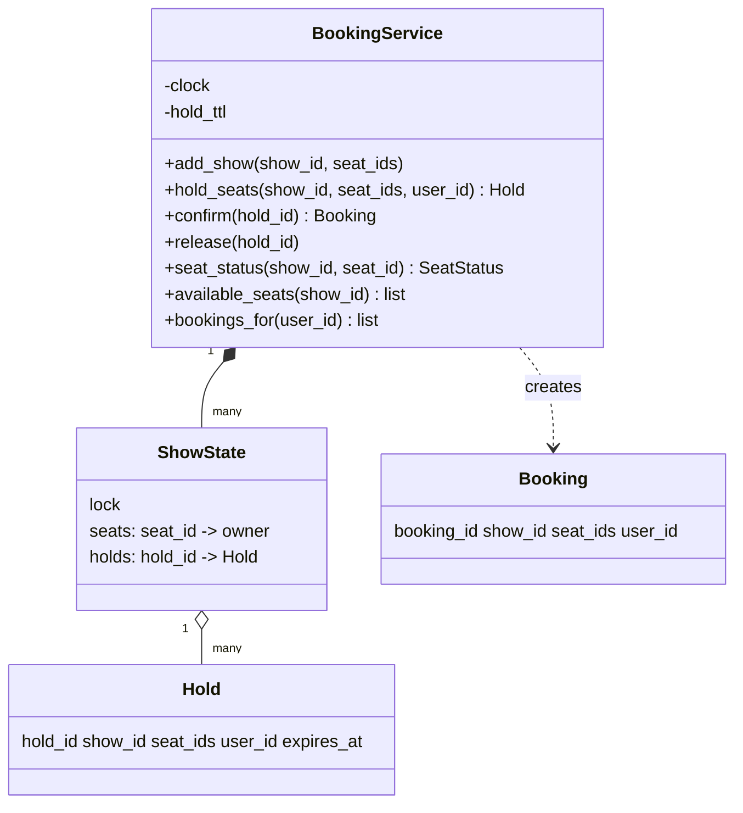

# LLD Problem 05: Seat booking (BookMyShow style) with holds and locks

The classic "concurrency" LLD question. The data model is easy; the interview is about **not double-booking** and **what happens when a user walks away mid-checkout**. Budget: 3-4 hours. Suggested split: read + sketch (30m), statuses and holds (1h), expiry (45m), locking + threaded tests (1h), review (30m).

## 1. Clarify requirements (ask these first)
- One theatre or many? Multiple screens/shows? (We model **show -> seats**; theatre/movie are metadata you can name but not build.)
- Seat categories and pricing (Gold/Silver)? Payment? (Out of scope; payment is the thing that happens *between* hold and confirm.)
- Can a user pick several seats at once? Must it be all-or-nothing? (Yes.)
- What happens if the user never pays? (Hold with TTL; seats return to the pool.)
- Is TTL per seat or per hold? Can a hold be extended? (Per hold, no extension.)
- Expected concurrency: one process with threads, or many servers? (Threads here; many servers means the DB owns the lock - say it.)
- Do we need cancellation of confirmed bookings, refunds, waitlists? (Follow-ups.)

State your assumptions out loud, then proceed.

## 2. Entities
| Entity | Responsibility |
|---|---|
| `SeatStatus` | AVAILABLE / HELD / BOOKED |
| `Hold` | frozen record: who holds which seats until when |
| `Booking` | frozen record: permanent result of confirm |
| `BookingService` | owns shows, locks, ids, the clock; the only mutator |
| Errors | `BookingError` base; `SeatUnavailableError`, `HoldExpiredError`, `InvalidHoldError`, `UnknownShowError`, `UnknownSeatError` |

## 3. Class diagram

Seat state machine: `AVAILABLE --hold--> HELD --confirm--> BOOKED`; `HELD --release/expiry--> AVAILABLE`. BOOKED is terminal.

## 4. Patterns and why
- **Derived state instead of timers**: store `expires_at`, compute status from `clock()`. No background thread to race with, trivially testable with a fake clock. (Lazy expiry; a janitor can compact memory later.)
- **Fine-grained locking**: one lock per show. Bookings for different shows never contend. A single global lock is correct but a scaling smell; per-seat locks need ordered acquisition to avoid deadlock (see Q&A).
- **Check-then-act inside one critical section**: "is it free?" and "mark it held" must be under the same lock. That is the whole problem.
- **State pattern (light)**: status transitions are explicit; you can promote to State objects if each state grows behaviour.
- **Immutable value objects** (`Hold`, `Booking`) are safe to hand to callers across threads.
- **Dependency injection** of the clock (same as the parking lot).

## 5. Spec summary (precise rules are in `exercises.py` docstrings)
- Seat is HELD while `clock() < expires_at`; at `>= expires_at` it is AVAILABLE.
- `hold_seats` is all-or-nothing; a failed call leaves no trace and burns no id.
- `confirm` on an expired hold -> `HoldExpiredError`; on unknown/used hold -> `InvalidHoldError`.
- `release` of an expired hold must NOT free a seat someone else has since re-held (compare the owning hold id).
- Hold/booking ids are global counters starting at 1 (guard the counter too).

## 6. Extensibility follow-ups interviewers ask
- Pricing per seat category / dynamic pricing -> `PricingStrategy` injected at confirm.
- Cancellation + refund -> `BOOKED -> AVAILABLE` transition, a `Booking.status`.
- Waitlist when a show is sold out -> queue per show, notify on release (Observer, see problem 07).
- Seat-map UI wants a consistent snapshot -> take the show lock, copy statuses.
- Multiple servers -> move truth to a DB: `UPDATE seats SET status='HELD', hold_id=?, expires_at=? WHERE show_id=? AND seat_id IN (...) AND (status='AVAILABLE' OR expires_at <= now)` and check affected rows == len(seats); or Redis `SET NX EX`.
- Max seats per hold / per user -> validation in `hold_seats`.
- Extend hold during payment -> `extend(hold_id)` with the same lock.

## 7. What to say out loud
1. "The invariant is: a seat is in at most one live hold or booking. I will protect it with one lock per show."
2. "I'll derive HELD/AVAILABLE from an expiry timestamp so there are no timer threads."
3. "hold is all-or-nothing, so I validate every seat under the lock before mutating any."
4. "Confirm re-checks expiry under the lock, because the user may confirm after the TTL."
5. "In a distributed deployment this lock becomes a conditional write in the database."

## 8. Common mistakes
- Checking availability outside the lock, then locking to write (classic TOCTOU double-booking).
- Mutating seats one by one and leaving partial holds when the 3rd seat fails.
- Using `time.time()` directly, or a `Timer` thread per hold (untestable, leaks threads).
- Releasing an expired hold and freeing a seat that now belongs to someone else.
- A single global lock held while calling out to payment (blocks everyone). Hold, release the lock, pay, then confirm.
- Forgetting the id counters are shared state and need protection too.
- Taking per-seat locks in arbitrary order -> deadlock between `[A1,A2]` and `[A2,A1]`.

## 9. Follow-up Q&A
**Q: Why not just a global lock?** A: Correct but serialises unrelated shows. Per-show lock keeps correctness with far less contention.

**Q: How would you do per-seat locks?** A: Acquire locks in sorted seat-id order for every request so there is a global lock order, which rules out deadlock. Release all in `finally`.

**Q: Why lazy expiry instead of a timer?** A: Timers add threads, ordering races (timer fires just as confirm runs) and test sleeps. Deriving status from `expires_at` is race-free under the lock.

**Q: Memory grows with expired holds. Fix?** A: Purge expired holds opportunistically in `hold_seats` for that show, or run a periodic sweep that takes the show lock.

**Q: What if payment succeeds after the hold expired?** A: `confirm` raises `HoldExpiredError`; the payment layer must refund or retry-hold. Mention idempotency keys for payment callbacks.

**Q: Optimistic vs pessimistic locking?** A: Pessimistic (locks) is simple for in-memory. In a DB, optimistic conditional updates scale better under low contention; under a flash-sale hot seat, queueing is better.

**Q: How do you test concurrency deterministically?** A: A `threading.Barrier` releases N threads at once on the same seat; assert exactly one success. Repeat many shows to raise the chance of exposing a race. No sleeps.

**Q: Where would the lock live if there are millions of shows?** A: Lock striping: `locks[hash(show_id) % 256]`.

## 10. Your task
Fill in `exercises.py`, then run
`.venv/bin/pytest 11-lld/problem-05-seat-booking -v`

Then, out loud and without notes: draw the state machine, explain why hold is atomic, and say what changes with two app servers.
