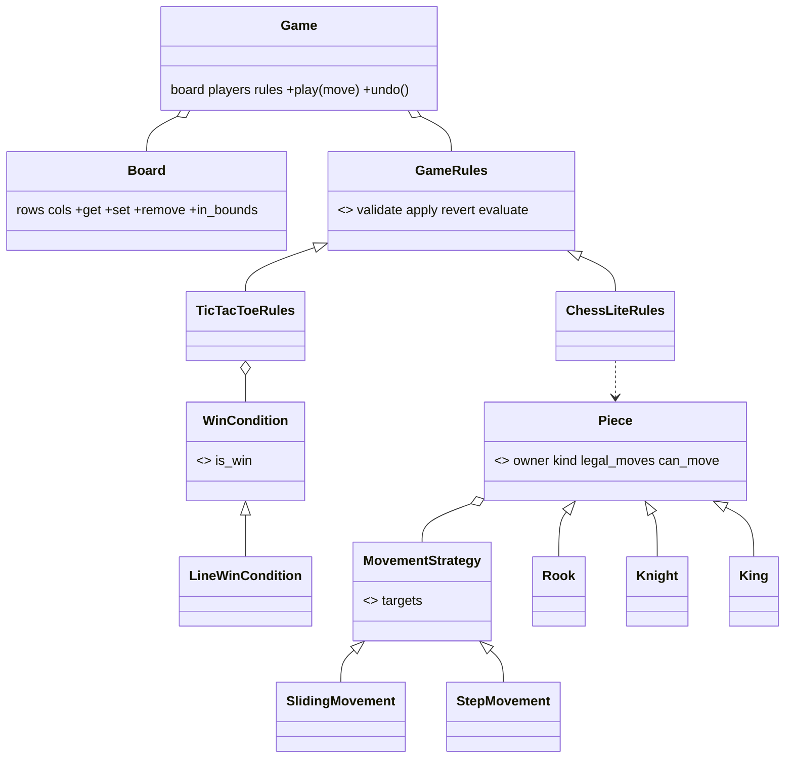

# LLD Problem 06: Board-game engine (tic-tac-toe NxN, chess-lite)

"Design tic-tac-toe" sounds trivial. The interview is really: **can you keep the engine independent of the rules**, so that "make it NxN", "connect-4 style win", or "now add chess" is a new class, not an edit. Budget: 3-4 hours. Suggested split: sketch (30m), board + value types (45m), Game + tic-tac-toe (1h), pieces/strategies (1h), undo + review (45m).

## 1. Clarify requirements (ask these first)
- Board size fixed 3x3 or NxN? Win length equal to N or configurable (connect-k)?
- Two players only, or N players? Human vs AI? (Players are just identities; AI is a move generator outside the engine.)
- Do we need undo/replay? Move history? Timers?
- Should the engine also support chess later? (Drives the design: placement vs movement, captures.)
- What does an illegal move do: exception or ignored? (We raise; state must be unchanged.)
- Who decides winner/draw: the game or the rules? (Rules; game orchestrates.)
- UI/persistence out of scope; engine is pure logic, so it is trivially testable.

## 2. Entities
| Entity | Responsibility |
|---|---|
| `Position`, `Player`, `Move` | immutable value objects |
| `Board` | grid of cells; bounds, get/set/remove; knows nothing about rules |
| `GameRules` (Strategy) | validate / apply / revert / evaluate for ONE game |
| `Game` | turn order, history, result, undo; orchestrates rules |
| `WinCondition` (Strategy) | pluggable "did this move win?" (`LineWinCondition(k)`) |
| `Piece` + `MovementStrategy` | chess-lite: what a piece may do, delegated to a strategy |
| Errors | `GameError` base: invalid move, out of turn, game over, nothing to undo |

## 3. Class diagram

## 4. Patterns and why
- **Strategy (GameRules, WinCondition, MovementStrategy)**: the varying parts are behaviours. `Game` never mentions "X", "king" or "row". New game = new `GameRules`, zero edits to `Game` (OCP).
- **Command (light)**: a `Move` is a value object; history stores `(move, captured)` so `undo` replays the inverse through `rules.revert`. Full Command objects with `execute/undo` are the next step if moves get complex.
- **Composition over inheritance for pieces**: `Rook` is just `Piece` + `SlidingMovement(ORTHOGONAL)`. A queen is sliding over ORTHOGONAL + DIAGONAL, a bishop is DIAGONAL: data, not new logic. (Do not subclass `Piece` per movement variant beyond a thin named wrapper.)
- **Template-ish orchestration** in `Game.play`: fixed order (over? turn? valid? apply? evaluate? advance) with game-specific hooks.
- **Immutable value types** make history and equality safe.
- **Simplicity guard**: do not build a Factory/Builder/Observer you cannot justify; say "I'd add X if Y".

## 5. Spec summary (exact rules are in `exercises.py` docstrings)
- `play` check order: game over, out of turn, rules.validate, apply, evaluate. A rejected move changes nothing.
- WIN on the board-filling move beats DRAW.
- Win check only scans the 4 lines through the last move: O(k) per move, not O(N^2).
- `undo` restores board, turn, result and winner; capture is remembered in history.
- Chess-lite: Rook/Knight/King movement, capture by landing on an enemy, win by capturing the king. No check detection, pawns, castling.

## 6. Extensibility follow-ups interviewers ask
- Connect-4 (gravity): new `GameRules` where `to.row` is derived from the column; same `LineWinCondition(4)`.
- Add Bishop/Queen: new `SlidingMovement` data, no engine change.
- Pawns: direction depends on owner and first-move flag; movement strategy needs piece state or `board`-aware capture rule (movement != capture) - split `MovementStrategy` into `move_targets` and `capture_targets`.
- Check/checkmate: `evaluate` simulates each opponent reply via apply/revert (that is why `revert` exists).
- AI player: `Player` gets a `choose_move(game)` strategy; engine unchanged. Minimax uses apply/revert for search.
- Replay/save: history is a list of immutable moves; replay = apply in order.
- Redo: keep an undone-stack, cleared on a new play.
- Timer per player: wrap `play` or inject a clock like earlier problems.
- Networked play: `Game` is pure; wrap in a service with a per-game lock (see problem 05).

## 7. What to say out loud
1. "The engine owns turn order and history; the rules own legality and outcome. That seam is the design."
2. "A move is validated before any mutation so a rejected move leaves no trace."
3. "Win detection only checks lines through the last move, O(k)."
4. "Undo needs the captured piece, so apply returns it and history stores it."
5. "Adding connect-4 or a queen is new code, not edits to Game. If I need to edit Game, my abstraction leaked."

## 8. Common mistakes
- Hard-coding 3x3 and the 8 win triples; or scanning the whole board after every move.
- Win check counting only one direction from the new cell (misses a move placed in the middle of a line). Count both ways.
- Checking `DRAW` before `WIN` on the last cell.
- Advancing the turn before validating, or mutating the board then raising.
- Putting `if game_type == "chess"` inside `Game`.
- Pieces that know about the whole game (`Piece.move()` mutating the board) instead of returning candidate squares.
- Sliding pieces that jump over blockers or can capture their own side.
- Comparing players by `is`/name instead of a value-equal frozen dataclass; letting two players share a symbol.
- Undo that forgets to restore the turn or leaves `winner` set.

## 9. Follow-up Q&A
**Q: Why does the Board not know the rules?** A: SRP. It is a data structure; rules change per game. It also lets the same Board back both games.

**Q: Where do you put "is it this player's turn"?** A: In `Game`; it is game-agnostic. Legality of the move itself is the rules' job.

**Q: How would you detect a draw early (no winning line possible)?** A: Extra `DrawDetector` strategy, or `evaluate` checks whether any line still has no both-player marks. Mention it is optional; full-board draw is the baseline.

**Q: How do you make the win check O(k)?** A: For each of 4 directions count contiguous equal cells both ways from the last move, add 1, compare to k.

**Q: Why store `(move, captured)` instead of board snapshots?** A: O(1) memory per move vs O(N^2). Snapshots are fine for tiny boards; mention the tradeoff.

**Q: How would you add check detection in chess?** A: After a candidate move, apply it, test whether own king is attacked by any enemy `legal_moves`, revert. Reject if attacked.

**Q: Is `Game.play` thread-safe?** A: No. Wrap with a lock per game when exposed over a network; the engine stays pure.

**Q: Singleton for the game/board?** A: No: hidden global state, tests cannot create fresh games, and a server runs many games.

## 10. Your task
Fill in `exercises.py`, then run
`.venv/bin/pytest 11-lld/problem-06-game-engine -v`

Then, out loud and without notes: draw the diagram above from memory, and explain exactly what you would write to add Connect-4.
