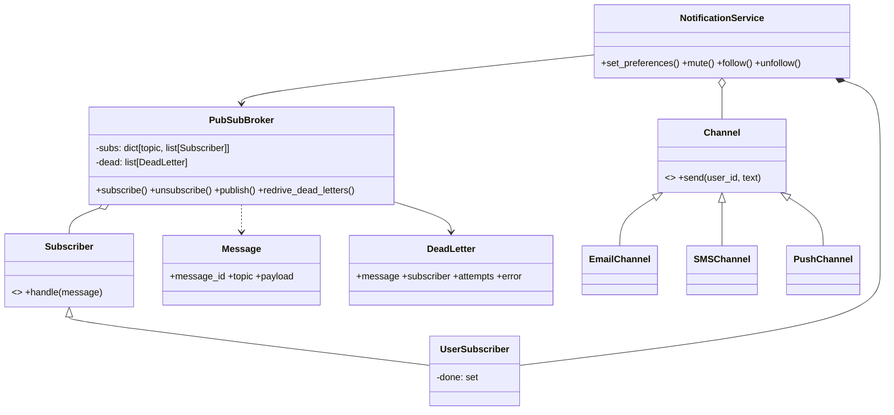

# LLD 07: Pub-sub broker + notification service

Classic "design a notification system / event bus" question. Core ideas: **Observer** (decoupled fan-out), **Strategy** (channels), retry with **exponential backoff**, **dead-letter** handling, and **idempotency** so retries don't double-send. Budget: ~45 min in an interview, ~3 hours to build here.

## 1. Requirements to clarify (ask these first)
- In-process library or distributed service? (Assume in-process; talk about Kafka/SQS later.)
- Sync or async delivery? Ordering guarantees? (Here: synchronous, subscription order.)
- Delivery semantics: at-most-once, at-least-once, exactly-once? (Retries make it at-least-once; idempotency recovers "effectively once".)
- What counts as failure, how many retries, what backoff? What happens after the last retry? (Dead-letter queue.)
- Can one bad subscriber block others? (No: isolation.)
- Channels: email / SMS / push? Per-user preferences? Muting? Templates? Priority? Rate limits?
- Scale: how many topics/subscribers? Persistence needed? (Out of scope: persistence, real threads.)
- Testability: how do we test backoff without sleeping? (Inject `sleeper`.)

## 2. Entities
| Entity | Responsibility |
|---|---|
| `Message` | immutable (id, topic, payload) |
| `Subscriber` (ABC) | `handle(message)`; raise to signal failure |
| `PubSubBroker` | topics -> subscribers, publish, retry, dead letters |
| `DeadLetter` | message + subscriber + attempts + last error |
| `Channel` (ABC) + fakes | how a notification physically leaves (email/sms/push) |
| `NotificationService` | per-user preferences, mute, follow/unfollow; adapts users to `Subscriber`s |

## 3. Class diagram

## 4. Patterns and why
- **Observer / pub-sub**: publishers know only a topic, never the consumers. Adding a consumer = zero change to publishers (OCP).
- **Strategy**: `Channel` implementations are interchangeable; a new channel (Slack) is a new class plus a dict entry.
- **Adapter**: `UserSubscriber` adapts "a user with preferences" to the `Subscriber` interface.
- **Dependency injection**: the `sleeper` (and channels, broker) are injected, so tests run instantly and deterministically.
- **Dead-letter queue**: poison messages don't loop forever or block the rest, and they remain inspectable and replayable.
- **Snapshot iteration**: publish iterates a copy of the subscriber list, so handlers that (un)subscribe cannot corrupt the loop.

## 5. Extensibility follow-ups interviewers ask
- Async delivery: a queue per subscriber + worker threads/asyncio; broker becomes a router.
- Ordering: per-topic (or per-key) FIFO; partitioning like Kafka.
- Filtering: subscribe with a predicate / content-based routing.
- Priorities and rate limiting per channel (reuse the rate limiter from problem 02).
- Templates and localization: payload becomes a template id + params.
- Persistence: outbox table, replay from offset, consumer groups.
- Jitter on backoff, max-delay cap, circuit breaker per channel.

## 6. What to say out loud
1. "I'll assume in-process and synchronous first, then discuss making it async."
2. "Delivery is at-least-once because of retries, so handlers must be idempotent. I track `(message_id, channel)` already done."
3. "A failing subscriber is isolated: I catch `Exception` (not `BaseException`) per subscriber, retry with exponential backoff, then dead-letter."
4. "Time is injected, so backoff is testable without sleeping."
5. "I iterate over a snapshot of subscribers so re-entrancy is safe."
6. "Not thread-safe by design; I'd guard topic maps with a lock or move to per-subscriber queues."

## 7. Common mistakes
- Calling `time.sleep` directly (untestable, slow tests).
- Sleeping after the final failed attempt.
- Letting one subscriber's exception abort delivery to the rest.
- Catching bare `except:` and swallowing `KeyboardInterrupt`.
- Retrying a multi-channel notification as a whole and sending duplicates on channels that already succeeded.
- Mutating the subscriber list while iterating it.
- Subscribing the same object twice (double delivery).
- Handing out a mutable internal list from `subscribers()` / `dead_letters()`.
- Hard-coding `if channel == "email"` chains instead of polymorphism.

## 8. Follow-up Q&A
**Q: At-least-once vs exactly-once?** Exactly-once is impossible end to end over unreliable links; do at-least-once plus idempotent consumers (dedupe key = message id).

**Q: Why exponential backoff?** Gives a struggling dependency room to recover and avoids synchronized retry storms; add jitter in production.

**Q: Retry in the broker or the subscriber?** Broker-level gives uniform policy; per-subscriber policy is a natural extension (policy object injected per subscription).

**Q: How would you make it concurrent?** Per-subscriber bounded queue + worker; publish just enqueues. Preserves isolation (slow subscriber backs up only its own queue); decide the backpressure policy (block, drop, spill).

**Q: How do you guarantee ordering with retries?** Either block the subscriber's queue until the head message succeeds (strict order) or accept reordering; partition by key.

**Q: What would you store for a real DLQ?** Message, subscriber id, attempts, error, timestamps; plus a redrive tool (we have `redrive_dead_letters`).

**Q: Why `Subscriber` as an ABC and not just callables?** Gives a named contract and room for state (like `done` set); callables can be adapted with a tiny wrapper.

**Q: How do user preferences stay consistent mid-retry?** Preferences are read at `handle` time; the `done` set ensures channels already served are not repeated.

## Your task
Fill in `exercises.py`, then run
`.venv/bin/pytest 11-lld/problem-07-pubsub-notifications -v`

Checklist: all tests pass; you can draw the diagram from memory; you can explain the backoff schedule `base * 2**(k-1)` and why there is no trailing sleep; you can describe how you'd add async delivery.
