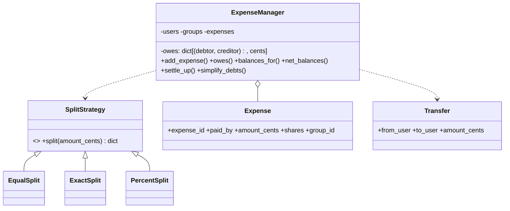

# LLD 08: Splitwise-style expense sharing

A favorite at Uber/Google-style rounds. It tests **modeling money correctly**, the **Strategy** pattern for split types, a clean ledger, and the **debt simplification** algorithm. Budget: ~45 min in an interview, ~3 hours to build here.

## 1. Requirements to clarify (ask these first)
- Who pays: one payer per expense, or several? (Assume one.)
- Split types: equal, exact, percent, shares? Can the payer be outside the split?
- Money: currency? Rounding rules? (Use **integer cents**; define who gets the leftover cent.)
- Groups: just a membership filter, or separate ledgers per group? (Here: filter; balances are global.)
- Do opposite debts net out between a pair? Partial settlements? Overpayment?
- Do we need "simplify debts", and does it change the ledger or only suggest transfers?
- Edit/delete expenses? History/audit? Multi-currency? Concurrency? (Out of scope; mention.)

## 2. Entities
| Entity | Responsibility |
|---|---|
| `ExpenseManager` | users, groups, expense log, pairwise ledger, settle, simplify |
| `Expense` | immutable record: payer, amount, per-user shares, group |
| `SplitStrategy` (ABC) | `split(amount_cents) -> {user: cents}`; sums exactly to amount |
| `EqualSplit` / `ExactSplit` / `PercentSplit` | concrete strategies, each validates itself |
| `Transfer` | one step of a simplified settlement plan |
| errors | `ExpenseError` base + `UnknownUserError`, `DuplicateError`, `InvalidSplitError`, `SettlementError` |

## 3. Class diagram

## 4. Patterns and why
- **Strategy** (`SplitStrategy`): a new split type (by shares, by item) is a new class; `ExpenseManager` never branches on split kind (OCP). The strategy also owns its validation (SRP).
- **Immutable value objects** (`Expense`, `Transfer`): safe to hand out, easy to audit.
- **Ledger of pairwise net debts**: store one non-negative number per ordered pair and cancel opposite directions on write, so reads are O(1).
- **Greedy simplification**: reduce the problem to net balances per person, then match biggest debtor with biggest creditor.
- **Exception hierarchy**: callers catch `ExpenseError` or a specific subclass.

## 5. Extensibility follow-ups interviewers ask
- Split by shares/weights or by line item; "payer also owes nothing" cases.
- Multiple payers per expense.
- Edit / delete an expense (recompute from the log or apply a reversing entry).
- Per-group balances and per-group simplification.
- Multi-currency (store `Money(amount, currency)`, convert at a rate captured at expense time).
- Notifications on new expense (reuse problem 07), recurring expenses, receipts.
- Persistence and concurrency: wrap `add_expense`/`settle_up` in a transaction/lock.

## 6. What to say out loud
1. "All money is integer cents; floats cannot represent 0.10 and rounding drifts."
2. "Every split must sum to the amount exactly. Equal split: floor share, and the first `amount % n` participants in listed order get one extra cent. I state the tie rule so results are deterministic."
3. "I keep a pairwise net ledger and cancel opposite debts on write."
4. "The invariant: net balances always sum to zero. I would assert it in tests."
5. "A failed `add_expense` must be atomic: validate everything before mutating, and don't consume an id."
6. "Simplify works on net balances: biggest debtor pays biggest creditor `min(debt, credit)`. This produces at most n-1 transfers. The true minimum is NP-hard (it is subset-sum-like), so greedy is the pragmatic answer; I can mention grouping zero-sum subsets as an optimization."

## 7. Common mistakes
- Using `float` for money (or `round()` per share and losing/creating cents).
- Equal split that ignores the remainder, so the shares do not add up.
- Treating the payer's own share as a debt to themselves.
- Not netting opposite debts, so `a owes b` and `b owes a` both show.
- Mutating state before validation completes (half-applied expense).
- `isinstance(True, int)` slipping through as an amount.
- Letting `settle_up` overpay and silently flipping the debt direction.
- Non-deterministic simplification (dict/set iteration order decides ties).
- Putting `if split_type == "equal"` in the manager.

## 8. Follow-up Q&A
**Q: Why integer cents rather than `Decimal`?** Ints are exact, fast, and force an explicit rounding policy; `Decimal` is fine but you still must decide who gets the leftover cent. Currencies with other minor units need a scale per currency.

**Q: Complexity of `add_expense`?** O(k) for k participants, with O(1) dict updates per pair. `net_balances` is O(P) over pairs (or O(1) if you maintain per-user nets incrementally).

**Q: Complexity of `simplify_debts`?** O(n^2) naive (scan for max each round, at most n-1 rounds); O(n log n) with two heaps.

**Q: Is greedy optimal?** It bounds transfers by n-1 but may not minimize them. The minimum equals n minus the maximum number of zero-sum groups, which is NP-hard in general.

**Q: How do you support editing an expense?** Keep the expense log as the source of truth and recompute the ledger, or post a reversing entry then the new one. Recompute is simple; reversing entries scale.

**Q: Why not store balances only per user?** You lose "who owes whom", which the UI needs. Pairwise ledger gives that; per-user nets give simplification input. Derive nets from pairs.

**Q: Should simplify change the ledger?** No: it is a read-only suggestion. Executing it would change who owes whom without a real payment, which users did not agree to.

**Q: Concurrency?** Two simultaneous `add_expense` calls interleave updates to the same pair. Guard with a lock (or one lock per group) and keep each mutation atomic.

## Your task
Fill in `exercises.py`, then run
`.venv/bin/pytest 11-lld/problem-08-expense-sharing -v`

Checklist: all tests pass; you can explain the remainder rule and why net balances sum to zero; you can walk the greedy on a 4-person example; you can name two ways to make it thread-safe.
