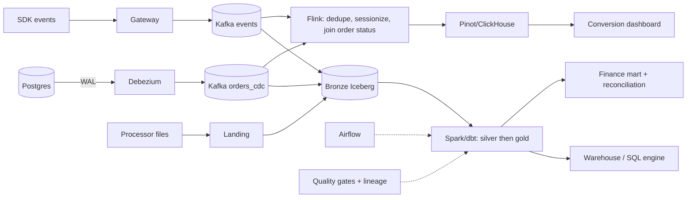

# Senior Data Engineer Mock Interview

A full loop in four rounds. Practice out loud with a timer, ideally with a partner reading the interviewer lines. Method for round 1: [week-07-pipeline-design/lesson.md](week-07-pipeline-design/lesson.md); worked designs in [week-07-pipeline-design/designs/](week-07-pipeline-design/designs/).

| Round | Time | Focus |
|---|---|---|
| 1. Pipeline design | 45 min | Requirements -> architecture -> deep dives -> ops |
| 2. SQL and modeling | 30 min | Window functions, dedupe, sessionization, gaps and islands, SCD2 |
| 3. Spark performance troubleshooting | 30 min | "Job takes 6 hours since last week" |
| 4. Behavioral for data engineers | 30 min | On-call, data-quality escalation, stakeholder pushback |

---

## Round 1: Pipeline design (45 min)

Prompt (interviewer reads): "We run a marketplace with 8M orders per day in Postgres and about 2B clickstream events per day. Product wants a near-real-time conversion dashboard, analysts want self-serve SQL on everything, finance wants a daily revenue report that ties out exactly, and the company has to honor deletion requests. Design the data platform."

### Stage 1: Clarify (0-7 min)

Interviewer prompts: (silence, then) "What would you like to know?"

Ideal answer (questions asked):
- Freshness per consumer: dashboard maybe 1-5 min; analysts hourly; finance daily by 07:00.
- Correctness: finance must tie to the order system to the cent; dashboard may be approximate.
- Sources: Postgres OLTP (can we read the WAL? any hard deletes?), clickstream via SDK, payments processor files.
- Volume and growth: 8M orders/day is about 100 per second average; 2B events/day is about 23K per second average, 70K peak (3x).
- History and backfill: how far back, how often do we reprocess?
- Compliance: PII fields, GDPR deletions, SOX for finance.
- Team and cloud: existing stack, team size.

Ideal framing sentence: "Three consumers with different needs, so likely a hybrid: streaming for the dashboard, batch with reconciliation for finance, one shared lakehouse in between. The hardest requirements are penny-exact finance and the deletion obligation."

Interviewer gives answers: dashboard freshness 5 min, finance by 07:00, Postgres allows logical replication, AWS, team of 6.

### Stage 2: Estimates (7-12 min)

Interviewer: "Size it."

Ideal answer:
- Events: 2B/day / 86,400 = about 23K/s avg, 70K/s peak. At about 300 bytes compressed in Kafka = 7 MB/s avg, 21 MB/s peak. Raw columnar about 0.5 TB/day, about 180 TB/year.
- Orders: 8M/day x 1 KB = 8 GB/day; CDC changes maybe 4x orders (status updates) = 32M change events/day, about 400/s. Tiny.
- Conclusion: clickstream dominates volume; orders dominate correctness. Different treatment for each.

### Stage 3: Architecture (12-25 min)

Interviewer: "Draw it."

Ideal answer (sketch, narrate one record end to end):



Talking points:
- Raw immutable bronze, replayable; all jobs idempotent.
- Dashboard path: event_id dedupe in Flink, event time with watermark; numbers provisional, corrected by batch.
- Orders: CDC mirrors with latest-LSN merge; finance reads from a cutoff snapshot, not live tables.
- Finance: control totals at landing, three-way reconciliation (orders vs payments vs processor), immutable daily snapshots, decimals not floats.
- PII tokenized at ingest into a small PII vault; everything else uses surrogate keys.

Interviewer follow-up: "Why not just stream everything?" Ideal: streaming for finance adds cost and complexity for no benefit since the SLA is next morning, and finance needs closed periods with audit trails; streaming is only justified for the 5-minute dashboard.

### Stage 4: Deep dive A, correctness of the dashboard vs finance (25-33 min)

Interviewer: "Dashboard says 10,200 orders today; finance says 10,150. Which is right and how do you handle this?"

Ideal answer:
- Finance/batch number is authoritative. Differences come from late events, refunds/cancellations after the dashboard counted, dedupe windows, and definitions.
- Fix by a single metric definition (semantic layer, shared code), and by labeling the dashboard "provisional until T+1".
- Build an automated diff job: hourly stream-vs-batch counts, alert if over a threshold, with a breakdown by cause.
- Backfill: dashboard OLAP offline segments replaced by batch for completed days.

### Stage 5: Deep dive B, deletion (33-40 min)

Interviewer: "A user requests deletion. Walk me through it."

Ideal answer: identity resolution -> PII inventory -> delete in OLTP first (else CDC re-propagates) -> batch MERGE/DELETE in lakehouse tables -> compaction and snapshot expiry so physical files are rewritten -> Kafka retention/tombstones -> feature store and caches -> verification scan -> audit log -> suppression list to prevent reload; backups by expiry; legal retention exceptions (invoices) pseudonymized. Mention crypto-shredding as an option if designed up front. Confirm with legal. See [design 8](week-07-pipeline-design/designs/08-gdpr-erasure.md).

### Stage 6: Ops, failure, evolution (40-45 min)

Interviewer: "It's 3 a.m. and the dashboard is stale. What happens?"

Ideal answer: freshness alert fires on the dashboard dataset (symptom-based); runbook: check Kafka consumer lag, Flink job status/checkpoints, OLAP ingestion; auto-restart from checkpoint; fallback banner "data delayed"; escalation path; postmortem and action items. Mention source-side risk (replication slot growth) and schema drift.

Interviewer: "What changes at 10x?" Ideal: more partitions, tiered Kafka storage, compaction/small files, pre-aggregation at edge, sampling for non-critical events, per-team cost attribution, and moving from one cluster to per-workload compute.

---

## Round 2: SQL and modeling (30 min, about 7 min each)

All four solutions below were run against SQLite 3.53 (window functions need SQLite 3.25+) with the sample data shown, and the outputs listed are what the queries returned. Syntax such as `julianday` and `date(x, '-N day')` is SQLite specific; in Postgres/Snowflake/BigQuery use `timestamp` arithmetic or `DATEADD`/`DATE_SUB`.

### Problem 1: Latest state from CDC events (dedupe, ignore deletes)

Interviewer: "Table `cdc_orders` has change events. Return the current state of each order, excluding deleted orders. Events can arrive out of order; `lsn` is the source log position."

Sample data:

```sql
create table cdc_orders(order_id int, status text, amount real, op text, lsn int);
insert into cdc_orders values
(1,'new',10,'I',100),(1,'paid',10,'U',105),(2,'new',20,'I',101),
(2,'new',20,'D',110),(3,'new',30,'I',102),(3,'shipped',30,'U',108),(3,'shipped',35,'U',107);
```

Solution:

```sql
with ranked as (
  select *, row_number() over (partition by order_id order by lsn desc) rn
  from cdc_orders)
select order_id, status, amount, lsn
from ranked
where rn = 1 and op <> 'D'
order by order_id;
```

Output: `(1, 'paid', 10.0, 105)` and `(3, 'shipped', 30.0, 108)`. Order 3 shows the out-of-order case: lsn 108 wins over 107 even if 107 arrived later. Order 2 is excluded because its latest event is a delete.

What interviewer listens for: order by LSN not arrival time; filter the delete after ranking (not before, or the older insert would resurrect the row); tie-breaking if LSN can tie.

### Problem 2: Sessionization with a 30-minute gap

Interviewer: "Given `events(user_id, ts, page)`, assign sessions where a gap over 30 minutes starts a new session, then report start, end, event count, and duration per session."

Sample data:

```sql
create table events(user_id int, ts text, page text);
insert into events values
(1,'2026-01-01 10:00:00','home'),(1,'2026-01-01 10:10:00','search'),(1,'2026-01-01 10:50:00','home'),
(1,'2026-01-01 10:55:00','buy'),(2,'2026-01-01 09:00:00','home'),(2,'2026-01-02 09:00:00','home');
```

Solution:

```sql
with f as (
  select user_id, ts,
    case when lag(ts) over (partition by user_id order by ts) is null
           or (julianday(ts) - julianday(lag(ts) over (partition by user_id order by ts))) * 1440 > 30
         then 1 else 0 end as new_sess
  from events),
s as (
  select *, sum(new_sess) over (partition by user_id order by ts
         rows between unbounded preceding and current row) as sess_no
  from f)
select user_id, sess_no, min(ts) start_ts, max(ts) end_ts, count(*) n_events,
       round((julianday(max(ts)) - julianday(min(ts))) * 1440, 1) minutes
from s
group by user_id, sess_no
order by user_id, sess_no;
```

Output:
- user 1, session 1: 10:00 to 10:10, 2 events, 10.0 min
- user 1, session 2: 10:50 to 10:55, 2 events, 5.0 min (the 40-minute gap splits it)
- user 2, session 1 and 2: one event each on different days, 0.0 min

Technique: flag session starts with LAG, then a running SUM of flags gives the session number. Follow-up: at scale this is a sort per user; in streaming use session windows; ties on identical timestamps need a secondary order key.

### Problem 3: Longest consecutive-day login streak (gaps and islands)

Interviewer: "From `logins(user_id, login_date)`, find each user's longest streak of consecutive days. Duplicates exist."

Sample data:

```sql
create table logins(user_id int, login_date text);
insert into logins values
(1,'2026-03-01'),(1,'2026-03-02'),(1,'2026-03-03'),(1,'2026-03-05'),(1,'2026-03-06'),(1,'2026-03-06'),
(2,'2026-03-01'),(2,'2026-03-03'),(2,'2026-03-04');
```

Solution:

```sql
with d as (select distinct user_id, login_date from logins),
g as (
  select user_id, login_date,
         date(login_date, '-' || (row_number() over (partition by user_id order by login_date)) || ' day') as grp
  from d),
streaks as (
  select user_id, grp, min(login_date) s, max(login_date) e, count(*) len
  from g group by user_id, grp)
select user_id, s, e, len
from (select *, row_number() over (partition by user_id order by len desc, s) rk from streaks)
where rk = 1
order by user_id;
```

Output: user 1: 2026-03-01 to 2026-03-03, length 3; user 2: 2026-03-03 to 2026-03-04, length 2.

Key idea: date minus row number is constant within a run of consecutive dates (the "island" key). Must dedupe first, or the duplicate on 03-06 would break the trick. Postgres version: `login_date - (row_number() over (...))::int`.

### Problem 4: Revenue by customer tier as of order date (SCD2 as-of join)

Interviewer: "`dim_customer` is SCD2 (`valid_from` inclusive, `valid_to` exclusive; open rows have 9999-12-31). Report orders, revenue, and revenue share by the tier the customer had when the order was placed."

Sample data:

```sql
create table dim_customer(customer_id int, tier text, valid_from text, valid_to text);
insert into dim_customer values
(1,'silver','2026-01-01','2026-02-01'),(1,'gold','2026-02-01','9999-12-31'),(2,'silver','2026-01-01','9999-12-31');
create table orders(order_id int, customer_id int, order_date text, amount real);
insert into orders values (1,1,'2026-01-15',100),(2,1,'2026-02-01',200),(3,1,'2026-03-10',50),(4,2,'2026-02-20',70);
```

Solution:

```sql
select d.tier, count(*) as orders, sum(o.amount) as revenue,
       round(100.0 * sum(o.amount) / sum(sum(o.amount)) over (), 1) as pct
from orders o
join dim_customer d
  on d.customer_id = o.customer_id
 and o.order_date >= d.valid_from
 and o.order_date <  d.valid_to
group by d.tier
order by revenue desc;
```

Output: gold 2 orders, 250.0, 59.5%; silver 2 orders, 170.0, 40.5%. Order 2 on exactly 2026-02-01 belongs to gold because intervals are half-open (valid_to exclusive); a closed-closed interval would double count it. A window over an aggregate (`sum(sum(...)) over ()`) gives share of total.

Modeling follow-ups (verbal, 3 min): grain of the order fact; why surrogate keys; type 1 vs type 2 vs type 3; handling late-arriving dimension rows; star vs one big table (OBT) tradeoffs; factless fact tables for events with no measure.

---

## Round 3: Spark performance troubleshooting (30 min)

Prompt (interviewer): "A nightly Spark job aggregates orders with customers and writes to a gold table. It used to finish in 50 minutes. Since last week it takes 6 hours. Nobody changed the code. How do you approach it?"

### Ideal approach: measure before guessing

1. Clarify what changed (the code did not, but data, cluster, config, library versions, upstream layout may have). Ask: input size trend, row counts, number of files, cluster/instance type or autoscaling policy, Spark version, shared cluster contention, any upstream job change.
2. Look at the Spark UI / history server for a good run and a bad run, side by side:
   - Which stage(s) got slower? Compare stage time, input size, shuffle read/write, number of tasks.
   - Within a slow stage: task duration distribution (min/median/max). One task running 100x longer than the median means skew. Uniformly slower means volume or resources.
   - Spill (memory/disk) and GC time per task.
   - Failed/retried tasks, executor loss, speculative tasks.
   - Scheduler delay or waiting for executors (resource starvation).

### Likely root causes and how each presents

| Symptom in Spark UI | Likely cause | Fix |
|---|---|---|
| Few tasks take hours, others seconds; max much greater than median | Data skew on a join/group key (one customer or NULL key exploded) | Check key distribution; salt hot keys, filter NULLs, enable AQE skew-join handling (Spark 3.x, check current docs), broadcast the small side |
| Input stage has tens of thousands of tiny tasks | Small-files problem from an upstream change (more frequent writes) | Compact upstream, increase batch size, use table-format compaction, tune `maxPartitionBytes` |
| Join switched from broadcast to sort-merge | Table grew above `autoBroadcastJoinThreshold`, or statistics became stale | Explicit broadcast hint if safe, refresh stats, raise threshold cautiously |
| Large shuffle spill to disk, high GC | Data volume growth, too few/too large partitions, insufficient executor memory | Increase shuffle partitions or rely on AQE coalescing, tune memory, avoid collecting large objects, use columnar and prune columns |
| Full scan instead of partition pruning | Filter changed to non-partition column, partition column type mismatch, or partitions layout changed | Fix predicates, check partition columns; verify pushdown in the plan |
| Cluster slower overall | Autoscaling capped, spot instance loss, noisy neighbor, different instance type | Check executor count over time; dedicated pool |
| Python UDF in the plan | Row-by-row serialization cost; data growth made it visible | Replace with native functions or pandas UDF/Arrow |
| Output stage slow | Writing too many small files or too few huge ones; dynamic partition overwrite with too many partitions; slow object storage commit | Repartition before write, use table format committer, coalesce thoughtfully |
| Retries and executor loss | OOM on skewed partition, shuffle fetch failures | Fix skew, memory overhead, external shuffle service |
| Data duplicated upstream (row count doubled) | Upstream bug or a backfill landed twice | Row-count and distinct-key checks, fix upstream; this is a correctness incident too |

### Worked scenario (interviewer reveals clues progressively)

Clue 1: "Stage 7 (the join of orders to customers) accounts for 5 hours. 200 tasks; 199 finish in 40 seconds, one runs 5 hours."
Ideal: classic skew. Check the top join keys by count. Reveal: a new enterprise customer, or a default/NULL `customer_id = -1` for guest checkout, now represents 30% of rows.

Clue 2: "customer_id = -1 is 30% of orders since the guest checkout launch last week."
Ideal fix (short term): filter or split the guest rows (they have no customer attributes to join), process them separately without the join; or enable AQE skew join; or salt the key. Long-term: the model should not join a placeholder key; make guests a separate path or use a null-safe approach; add a data quality check on key distribution (max key share) to alert on future skew.

Clue 3: "After the fix it runs in 70 minutes, but the old run took 50."
Ideal: investigate the remainder: input volume grew 40%, small files from the new event frequency; check file counts, run compaction, tune partitions; consider incremental processing (only changed partitions) rather than full recompute; capacity plan.

Closing the loop: prevent recurrence with a runtime SLO alert (job duration p95), stage-level metrics exported, a skew detector on join keys, and a runbook. Do a blameless note on how a business launch changed data without notifying data engineering (data contracts / change communication).

### Rapid-fire questions in this round
1. Narrow vs wide transformations? Wide transformations require shuffle (groupBy, join, repartition).
2. When is broadcast join wrong? Small side not actually small, memory pressure on driver/executors, or frequent growth.
3. `repartition` vs `coalesce`? Repartition full shuffle, can increase or balance; coalesce narrow, only decreases, may leave skew.
4. How does AQE help? Coalesces shuffle partitions, switches join strategies at runtime, splits skewed partitions (check current docs for defaults per version).
5. Cache or persist: when? When a computed dataset is reused several times and fits; otherwise it wastes memory and may slow things.
6. What causes executor OOM? Skewed partitions, large collect, too many cores per executor for memory, big broadcast, Python memory overhead.

---

## Round 4: Behavioral for data engineers (30 min)

Use the STAR structure (Situation, Task, Action, Result) plus a closing "what I changed afterwards". Senior signals: ownership, blast radius thinking, communication, systemic fixes (not hero fixes), and quantified outcomes.

### Q1: Tell me about an on-call incident you handled.

Strong answer structure:
- Situation: pipeline failure/late data affecting a named consumer (for example the 07:00 finance report was going to miss SLA), paged at 3 a.m.
- Action: triage by consumer impact first (who is affected, what's the deadline), mitigated before root-causing (publish previous snapshot flagged stale, rerun with a smaller scope), communicated early and regularly in the incident channel, then root-caused (for example upstream schema change), fixed.
- Result: time to detect, time to mitigate, number of consumers affected; follow-ups: schema contract check, alert on freshness, runbook, blameless postmortem.
- Probe: "What would you do differently?" Look for specific detection and prevention changes, not "be more careful".

Red flags: only heroics, no communication, no prevention, blaming upstream team.

### Q2: A dashboard number is wrong and an executive has already used it in a decision. What do you do?

Strong answer: confirm and quantify the error; stop the bleeding (flag/pull the dashboard or add a banner); notify stakeholders promptly with what is known, impact, and ETA rather than waiting for the full root cause; fix and backfill; restate numbers with a clear changelog; root-cause (missing test, definition drift, join fan-out); add automated checks (reconciliation, grain tests); share a short postmortem. Show you treat trust as the product.

### Q3: Describe a data quality escalation you drove across teams.

Strong answer: found a recurring issue (for example null `country` from a service), measured the cost (analyst hours, wrong KPIs), engaged the producing team with evidence and a proposal (contract plus validation at the source), agreed on owners and SLAs, implemented monitoring on both sides, and tracked the metric (null rate from 8% to 0.2%). Highlights influence without authority.

### Q4: A stakeholder insists on real-time data for a report that is viewed once a day. How do you respond?

Strong answer: understand the underlying need; show cost and complexity tradeoffs with numbers; offer options (hourly micro-batch, a fast provisional view plus accurate daily); propose a pilot or revisit criteria; accept when the business value justifies it; document the decision. Respectful, data-driven, not dogmatic.

### Q5: Product asks for a metric by Friday but the data is unreliable. What do you do?

Strong answer: define what can be delivered reliably, communicate risk clearly, ship an explicitly labeled provisional version with caveats and known gaps, plan the proper fix with a date, and avoid silent compromises. Escalate trade-offs to the decision owner.

### Q6: Tell me about a time you disagreed with a technical decision (for example Lambda vs a unified pipeline, or buying vs building).

Strong answer: state the options and criteria, gather evidence (a small prototype or cost model), disagree and commit if overruled, and track the outcome. Show humility and curiosity.

### Q7: How do you mentor and raise the team's data engineering bar?

Strong answer: templates and golden-path pipelines, code review checklists (idempotency, tests, backfill, observability), design reviews, runbooks, pairing, blameless postmortems, and measuring improvement (incident count, onboarding time).

### Q8: Tell me about a project you would run differently now.

Strong answer: honest assessment (for example over-engineered streaming where batch sufficed), what you learned, and how you apply it. Avoid disguised strengths.

---

## Scoring rubric

Score each dimension 0-4 (0 absent, 1 weak, 2 adequate, 3 strong, 4 exceptional/senior-plus).

### Round 1: Pipeline design (max 32)

| Dimension | 4 looks like |
|---|---|
| Requirements | Asks about freshness, correctness, consumers, compliance; names the hardest requirement |
| Estimation | Correct arithmetic; draws a design conclusion from the numbers |
| Architecture | Coherent layers, right batch/stream split, no unnecessary components, one record traced end to end |
| Correctness semantics | Idempotency, dedupe, late data, ordering, exactly-once effect explained with mechanisms |
| Storage and modeling | Layering, table formats, partitioning, schema evolution, SCD handling |
| Quality and observability | Gates with block/warn policy, freshness alerts, lineage, runbooks |
| Failure and recovery | Specific failure modes, backfill plan, rollback, DLQ |
| Cost, security, evolution | Cost levers, PII/deletion, 10x plan, tradeoffs stated |

### Round 2: SQL and modeling (max 20)

| Dimension | 4 looks like |
|---|---|
| Correctness (x4 problems, 0-4 each, average counted below) | Runs on sample data, handles edge cases (ties, duplicates, deletes, boundaries) |
| Technique | Picks window functions naturally; explains why (running sum of flags, row_number trick) |
| Communication | States grain, assumptions, tests with a tiny example before finishing |
| Modeling | Defends grain, keys, SCD choice, star vs wide tradeoffs |
| Performance awareness | Mentions sort/shuffle cost, indexes/partitions, alternatives at scale |

Score the correctness row as the average of the four problems (0-4), then add the other four rows for a total of 20.

### Round 3: Spark troubleshooting (max 20)

| Dimension | 4 looks like |
|---|---|
| Method | Measures first (Spark UI, compare good vs bad run), narrows by stage/task, forms hypotheses |
| Technical depth | Skew, small files, shuffle, spill, join strategy, AQE explained correctly |
| Fixes | Short-term and long-term fixes; knows tradeoffs |
| Prevention | Alerts on duration and skew, data-contract on change, runbook |
| Communication | Thinks aloud, asks for data, does not guess a single cause |

### Round 4: Behavioral (max 20)

| Dimension | 4 looks like |
|---|---|
| Ownership | Took responsibility beyond the ticket |
| Incident handling | Mitigate first, communicate, root cause, systemic prevention |
| Stakeholder management | Aligns on needs, offers options with tradeoffs, holds boundaries respectfully |
| Influence and mentoring | Drives cross-team change, uplifts others |
| Reflection | Honest learning, measurable results |

### Totals and interpretation

Total possible: 32 + 20 + 20 + 20 = 92.

| Total | Signal |
|---|---|
| 74-92 | Strong hire at senior level |
| 60-73 | Hire/borderline; depends on role gaps (note weakest round) |
| 45-59 | Not yet; repeat the weakest round after targeted study |
| Under 45 | Revisit fundamentals (lessons in weeks 1-7) |

### Self-scoring sheet (copy per attempt)

```
Date: ____   Round: ____   Prompt: ____
Scores: Req _ Est _ Arch _ Semantics _ Storage _ Quality _ Failure _ Cost/Sec _
Time overruns: ____
Hint count: ____
Top 3 gaps: 1) ____ 2) ____ 3) ____
Next drill: ____
```
