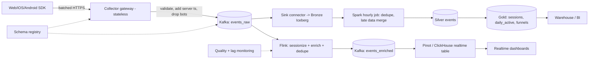

# Design 1: Clickstream / Event Analytics Pipeline

Prompt: "Design the pipeline that collects web and mobile events from 50M daily active users and powers product analytics (funnels, retention, sessions) and executive dashboards."

## Requirements

Functional
- Collect page views, clicks, and custom events from web, iOS, Android.
- Sessionize, enrich (geo, device, user attributes), and join with user dimensions.
- Serve: (a) analyst SQL on full history, (b) dashboards with data under 5 minutes old, (c) funnel and retention queries.

Non-functional
- Freshness: dashboards under 5 min; analyst tables hourly is acceptable.
- Loss tolerance: very low (under 0.1% loss), duplicates must be removed downstream.
- Late events: mobile clients batch offline; up to 48 h late.
- Privacy: consent flag respected, IP truncated, user ids pseudonymous; deletion supported (see design 8).
- Out of scope: ad attribution, A/B stats engine.

## Capacity estimates

- 50M DAU x 60 events/day = 3B events/day.
- Average = 3B / 86,400 = about 35K events/s. Peak 3x = about 100K events/s.
- Raw event about 1 KB JSON; Avro/Parquet compresses to about 150-250 bytes. Raw JSON/day = 3 TB; columnar = about 0.6 TB/day, about 220 TB/year before replication.
- Kafka (assume about 300 bytes/event compressed on the wire): average 35K/s x 300 B = about 10 MB/s, peak about 30 MB/s. Storage: 10 MB/s x 86,400 = about 0.9 TB/day; 7-day retention x replication 3 = about 18 TB. Partitions: 30 MB/s at about 5 MB/s per partition = at least 6; use 64-128 for consumer parallelism and headroom.
- Hot serving store: last 90 days pre-aggregated, a few TB.

## Architecture

## Data model

Bronze `events_raw` (append-only, partitioned by `ingest_date`, `ingest_hour`):
`event_id (uuid from client), event_name, user_id, anonymous_id, session_hint, event_ts_client, received_ts_server, props (map/JSON), app_version, platform, ip_trunc, consent`.

Silver `events` (partitioned by `event_date` derived from corrected event time): typed props for top events, `event_id` unique, `event_ts` = client ts clamped to server ts if clock skew exceeds a bound.

Gold: `sessions(session_id, user_id, start_ts, end_ts, n_events, landing_page, ...)`, `daily_user_activity`, `funnel_steps`. OLAP table: `events_agg(minute, event_name, platform, country, count, uniq_hll)`.

## Step-by-step flow

1. SDK batches events, retries with the same `event_id` (client generated) so server dedupe works.
2. Gateway validates against schema registry, adds `received_ts`, rejects oversize payloads, writes to Kafka keyed by `anonymous_id`/`user_id` (keeps a user's events in-partition for ordering and sessionization).
3. Kafka sink writes Bronze files (Parquet) every few minutes; compaction job merges small files.
4. Flink job: event-time windows with watermark (for example 2 min bounded out-of-orderness), session windows with 30-min gap, enrich with a broadcast user-dimension snapshot, drop duplicates using keyed state with TTL (about 1 h) on `event_id`.
5. Enriched stream goes to OLAP real-time ingestion for the 5-minute dashboards. These numbers are provisional.
6. Hourly Spark job reads Bronze for `[t-48h, t]`, dedupes by `event_id` globally, recomputes sessions for affected users/dates, and MERGEs into Silver/Gold. This is the source of truth; dashboards converge to it.
7. Orchestrator publishes Gold when quality checks pass; a freshness metric is emitted.

## Failure modes

| Failure | Handling |
|---|---|
| Duplicates from client retries or at-least-once Kafka | `event_id` dedupe in stream (bounded TTL) and in batch (global) |
| Late events (48 h) | Batch reprocess window; stream numbers are provisional, corrected on next batch merge |
| Bot/spam traffic spike | Rate limit at gateway, bot filter, quota per key; keep raw in quarantine topic |
| Schema change in SDK | Schema registry with backward compatibility; unknown fields into `props` map |
| Kafka consumer lag after deploy | Autoscale consumers up to partition count; checkpointed restart; alert on lag seconds not message count |
| Hot partition (one giant user/bot) | Key by `anonymous_id` and cap per-key rates; salt for non-session aggregates |
| Clock skew in clients | Use server received time as upper bound; clamp |
| Flink state loss | Checkpoints to object storage; bronze replay as last resort |

## Trade-offs

- Dual path (stream + batch) gives speed and correctness but two code paths. Mitigation: share transformation logic as a library, or use one engine in two modes; accept dashboards being "approximately right, then corrected".
- Exactly-once in Flink needs transactional or idempotent sinks; at this volume dedupe by `event_id` is simpler and more robust.
- OLAP store (Pinot/ClickHouse/Druid) vs warehouse for dashboards: OLAP wins on sub-second high-concurrency; costs extra system to run. If dashboards tolerate 30 s and low concurrency, serve from the warehouse.
- Sessionize in stream vs batch: stream is fresh but complex with late data; many teams only do batch sessionization and show stream-only counts.
- Approximate distinct counts (HyperLogLog) save storage but cannot be re-grouped exactly across all dimensions without sketches.

## Follow-up questions

1. How do you handle a 2-hour outage of the gateway? (client-side buffering, SDK retry with jitter, replay)
2. How do you compute 30-day retention efficiently? (daily active bitmaps or per-user first-seen cohort table, avoid scanning events)
3. How would you add GDPR deletion? (pseudonymous ids, deletion index, rewrite partitions; see design 8)
4. How do you stop one event type from blowing up cardinality in OLAP? (dimension allow-list, cardinality limits, drop to bronze only)
5. How do you validate that the stream and batch numbers agree? (hourly diff job with tolerance, alert on drift)
6. How would you change this for 10x volume? (more partitions, tiered Kafka storage, sample or pre-aggregate at edge, cheaper cold storage)
