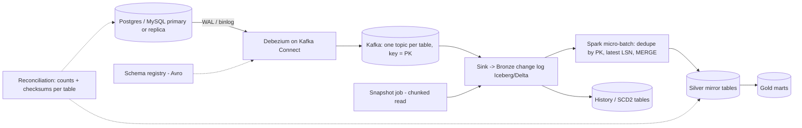

# Design 2: CDC from an OLTP Database to a Warehouse / Lakehouse

Prompt: "Replicate our 400 operational Postgres/MySQL tables into the lakehouse so analysts see data within 5 to 10 minutes, including updates and deletes, without hurting production."

## Requirements

Functional
- Initial full load, then continuous change capture of inserts, updates, deletes.
- Current-state tables ("mirror") and optionally full change history (SCD2 / audit).
- Handle schema changes (add column, type widen) with minimal manual work.

Non-functional
- Freshness 5-10 min; correctness: the mirror must equal the source at a point in time (verified).
- Load on the source: near zero (read the log, not the tables).
- Ordering per primary key must be preserved; deletes must propagate.
- Security: PII columns masked or tokenized on the way in.
- Out of scope: bidirectional sync, writing back to OLTP.

## Capacity estimates

- Total source size 2 TB; write rate 3,000 row changes/s average, 15K peak (batch jobs).
- Change event about 1 KB with before/after images: peak 15 MB/s; daily = 3,000 x 86,400 = 260M changes, about 260 GB/day raw, about 50 GB/day compressed Parquet.
- Mirror table merge: with a 5-min micro-batch, 900K changes per batch, trivial for Spark; the cost is rewriting touched files, so partitioning and clustering matter more than volume.
- Kafka: 400 tables -> 400 topics (or grouped); partitions per topic by table volume (1-12).

## Architecture

## Data model

Bronze change log per table: `pk columns, op (c/u/d/r), before (optional), after, source_ts, ingest_ts, log_position (LSN or binlog file+pos), txn_id, schema_version`.

Silver mirror: the source columns plus `_deleted boolean` (soft delete), `_source_lsn`, `_updated_at`. Merge key = PK.

History (SCD2): `pk, attrs..., valid_from, valid_to, is_current` built from ordered change events.

## Step-by-step flow

1. Create a replication slot (Postgres) or note the binlog position, then take a consistent snapshot. Debezium does snapshot + streaming handoff itself; for very large tables use incremental/chunked snapshots (Debezium incremental snapshots, check current docs) so streaming and backfill run together.
2. Debezium emits an event per row change to Kafka, keyed by PK, preserving per-key order. Snapshot rows are marked `op = r`.
3. Bronze sink appends events unchanged. This is the replayable record.
4. Every 5 min Spark micro-batch reads new Bronze events, keeps the latest event per PK using `row_number() over (partition by pk order by log_position desc)`, then `MERGE INTO silver`:
   - matched and `op = d` -> delete (or set `_deleted`)
   - matched and newer LSN -> update (guard with `source_lsn > target.source_lsn`)
   - not matched and not delete -> insert
5. Schema change: Debezium picks up DDL; schema registry validates compatibility; additive columns are auto-added to Bronze and Silver; breaking changes route to an approval queue and the table is paused rather than corrupted.
6. Reconciliation job (hourly/daily): per table compare `count(*)` and a rolling checksum (sum of hashes by PK range) between source replica and Silver at a fixed LSN/time; alert on mismatch.

## Failure modes

| Failure | Handling |
|---|---|
| Replication slot not consumed -> WAL fills source disk | Alert on slot lag/bytes, heartbeat events, max slot size limits, runbook to drop and re-snapshot |
| Connector restart replays events | Merge is idempotent via LSN guard |
| Out-of-order across tables | Do not assume cross-table order; join on eventual consistency or use txn_id for atomic groups |
| Hard deletes missed (query-based CDC) | Use log-based CDC or periodic full-key diff |
| Large transaction or bulk update (10M rows) | Backpressure, bigger batches, isolate heavy tables to own connector |
| DDL incompatible change | Pause table, alert owner, replay from Bronze after migration |
| TOAST/unchanged columns not in event (Postgres) | Set replica identity full on affected tables or merge with previous values (check current docs) |
| Snapshot and stream gap | Use connector-provided consistent snapshot offset, validate with reconciliation |
| Source failover changes log positions | Use logical slots on primary with failover support (version specific, check current docs) or re-snapshot |

## Trade-offs

- Log-based CDC vs timestamp-based incremental: log-based captures deletes and intermediate states with low load, but needs DB config privileges and ops. Timestamp polling is simpler but misses deletes and has race windows.
- Merge-on-read vs copy-on-write tables: merge-on-read favors write-heavy CDC with periodic compaction; copy-on-write favors read performance. Choose per table churn.
- Mirror latency vs cost: 5-min micro-batches rewrite files often; 15 min cuts cost. Ask whether true 5 min is needed.
- Managed service (DMS, Datastream, Fivetran, Airbyte) vs self-run Debezium: managed is faster to launch; self-run offers control and lower per-row cost at scale (check current docs for connector support).
- Soft vs hard delete in Silver: soft keeps audit but must be filtered in views; hard simplifies queries but conflicts with history needs.

## Follow-up questions

1. How do you backfill one table that was corrupted? (re-snapshot into a side table, replay change log from snapshot LSN, swap)
2. How do you guarantee the snapshot and stream do not lose or duplicate rows at handoff?
3. Two tables updated in one transaction: how do analysts see a consistent view? (txn markers, publish only up to a safe watermark LSN common to all tables)
4. How do you handle PII columns? (hash/tokenize in a Kafka SMT or first processing step; separate restricted table)
5. How would you produce SCD2 from out-of-order events? (order by LSN, window functions with lead for valid_to)
6. What do you monitor? (slot lag, connector status, end-to-end commit-to-visible latency, reconciliation diff, DLQ size)
