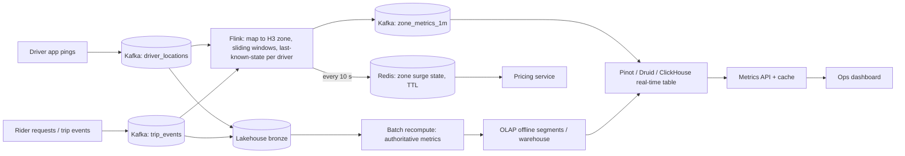

# Design 3: Real-Time Dashboard / Metrics (Ride-Hailing Surge and ETA Stats)

Prompt: "For a ride-hailing app, build the pipeline behind a live ops dashboard and the surge pricing signal: demand, supply, and ETA statistics per city zone, updated every few seconds."

## Requirements

Functional
- Per zone (hexagon, for example H3 resolution 8) and per minute: ride requests, available drivers, completed trips, p50/p90 ETA, cancellation rate.
- Surge multiplier input: demand/supply ratio over a sliding window (for example last 2 min, updated every 10 s).
- Ops dashboard: city maps, drill-down by zone, compare to last week same time.
- Historical analysis in the warehouse (same metrics, authoritative).

Non-functional
- End-to-end latency: under 10 s for surge input, under 30 s for dashboard.
- Availability higher than correctness: a slightly stale or approximate number beats no number; the batch layer corrects later.
- Dashboard concurrency: 500 ops users, plus an internal pricing service calling an API at 2,000 QPS.
- Out of scope: pricing algorithm itself, driver dispatch.

## Capacity estimates

- 5M trips/day, 1M concurrent peak active drivers x location ping every 4 s = 250K pings/s peak (this is the dominant stream).
- Ping 100 bytes -> 25 MB/s peak. Trip/request events are about 100 per second average, small.
- Zones: 100 cities x 2,000 hexes = 200K zones. Per-minute metric rows = 200K x 1,440 = 288M rows/day if all zones active (most are sparse; assume 30M/day).
- Stored aggregates at 30M rows/day x 100 bytes = 3 GB/day, 1 TB/yr, small for OLAP.

## Architecture

## Data model

Stream topics (keyed by `driver_id` / `zone_id` as appropriate; Avro):
- `driver_locations(driver_id, lat, lon, status, event_ts)`
- `trip_events(trip_id, rider_id, driver_id, type[requested|accepted|cancelled|completed], zone_id, event_ts, eta_predicted, eta_actual)`

OLAP table `zone_metrics_1m`: dimensions `minute_ts, city, zone_id`; metrics `requests, supply_avg, completions, cancels, eta_p50, eta_p90 (t-digest/quantile sketch)`. Time column plus city as primary filter/partition; star-tree/rollup indexes as provided by the engine (check current docs).

Redis: `surge:{zone_id}` -> `{demand, supply, ratio, window_end, version}` with short TTL so stale zones expire to default 1.0.

## Step-by-step flow

1. Flink consumes pings and trip events, assigns zone via H3 index of lat/lon, uses event time with 5-10 s watermark (late pings beyond this are dropped from the real-time path only).
2. Supply: keyed state per driver holds latest status/zone; a zone-level count is computed by diffing zone transitions (count of available drivers) rather than scanning pings.
3. Demand: tumbling or sliding windows of requests per zone.
4. Emit zone metrics every 10 s to Redis (for pricing) and 1-minute rollups to Kafka -> OLAP.
5. Dashboard queries the OLAP engine (sub-second group-by on time + zone) through a thin API with short-TTL cache (5-10 s) to absorb dashboard refresh storms.
6. Batch layer recomputes day D from lakehouse with exact deduped, late-corrected data; OLAP offline segments replace the real-time ones for completed days (hybrid table pattern).
7. A daily job compares real-time vs batch metrics to measure the real-time error and alert if it drifts.

## Failure modes

| Failure | Handling |
|---|---|
| Flink job crash | Restart from checkpoint (seconds-minutes); pricing falls back to last Redis value with TTL, then default multiplier |
| Hot zone (stadium event) | Zone key skew: two-stage aggregation (partial per subtask then merge), or salt zone key |
| GPS noise / duplicate pings | Dedupe by (driver_id, ts bucket), drop impossible speeds |
| Late/out-of-order data | Watermark + allowed lateness for updates; beyond that only batch corrects |
| Redis outage | Pricing service uses cached local value, then safe default; Redis replicas |
| OLAP node loss | Replicated segments, query retries; dashboard shows "data delayed" banner using freshness metric |
| Metric definition drift between stream and batch | Single shared definition library and daily diff check |
| Feedback loop (surge changes demand, which changes surge) | Smoothing, caps on multiplier change rate (product decision) |

## Trade-offs

- Flink vs Spark Structured Streaming: Flink has lower latency and richer state/time semantics; Spark is easier if the team already runs it and seconds-to-minutes is acceptable.
- OLAP engine vs warehouse for the dashboard: OLAP gives sub-second concurrent queries on fresh data; a warehouse is simpler but slower and costlier per query at this concurrency.
- Pre-aggregate in stream vs raw ingest to OLAP: raw gives flexibility but 250K rows/s is heavy; pre-aggregation reduces load 100x but locks dimensions.
- Approximate quantiles (t-digest) are mergeable across time and zones; exact percentiles are not.
- Accept approximate real-time numbers plus a corrected batch view (and say so on the dashboard) rather than chasing exactly-once at the metric level.

## Follow-up questions

1. How do you do "compare to same time last week" efficiently? (store minute rollups, query two time ranges, align by minute-of-week)
2. A zone has zero events: how do you distinguish no demand from a broken pipeline? (heartbeat events, per-partition watermark and freshness checks)
3. How do you backfill after a Flink bug produced wrong supply counts for 3 hours? (replay from Kafka/lakehouse into offline segments, replace affected time range)
4. How do you size Kafka partitions for 250K msgs/s? (about 25 MB/s; 12-48 partitions with headroom; key by driver for ordering)
5. How would you test the pipeline? (replay recorded traffic, golden-file windows, chaos kill of Flink task managers)
6. How do you keep the pricing service decoupled from the dashboard path? (separate sink, own SLO, simpler fallback)
