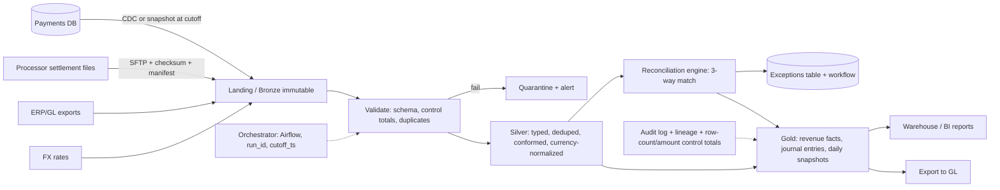

# Design 4: Batch ETL for Daily Finance Reporting with Strong Reconciliation

Prompt: "Build the daily pipeline that produces revenue and settlement reports for the finance team from payments, orders, refunds, and bank files. Numbers must tie out to the penny and be auditable."

## Requirements

Functional
- Ingest from: payments DB (CDC or daily extract), payment-processor settlement files (CSV/SFTP), ERP/GL exports, FX rates feed.
- Produce daily and month-end reports: gross/net revenue, refunds, fees, taxes, by entity/currency/product; ledger-ready journal entries.
- Reconcile: orders vs payments vs processor settlement vs bank statements; list unmatched items.
- Corrections: late refunds and restatements must be handled with a full audit trail.

Non-functional
- Deadline: reports ready by 07:00 local time; month-end close within 2 business days.
- Correctness above all: totals tie to source systems to the cent, deterministic re-runs produce identical output.
- Auditability: SOX-style lineage, who ran what, immutable inputs, 7-year retention.
- Security: restricted access, PII/card data excluded (tokens only), change management.
- Out of scope: real-time reporting, tax filing.

## Capacity estimates

- 20M transactions/day x 500 bytes = 10 GB/day raw; 3.6 TB/year; plus settlement files (a few GB/day).
- Compute is small: a Spark/warehouse job over a day's partitions takes minutes. Cost is dominated by correctness work, not scale.
- Reconciliation joins: 20M payments x 20M settlement lines per day, trivial for a distributed join (hash join on transaction id).

## Architecture

## Data model

- `fact_transaction(txn_id, order_id, account, entity, currency, amount_minor_units, fx_rate_id, amount_reporting_ccy, txn_type [sale|refund|fee|chargeback], posted_date, source_system, source_batch_id, load_run_id)`. Amounts as integer minor units or DECIMAL; never float.
- `recon_match(txn_id, source_a_id, source_b_id, status [matched|amount_diff|missing_in_processor|missing_in_bank], diff_amount, run_id)`.
- `fct_daily_revenue_snapshot(report_date, as_of_run_id, entity, currency, gross, refunds, fees, net)`: append snapshots per run, never overwrite, so earlier published numbers remain reproducible.
- `control_totals(source, batch_id, row_count, sum_amount, hash, received_at)` captured on arrival.
- `dim_fx_rate` with `rate_date` and source; SCD2 on any dimension used for reporting.

## Step-by-step flow

1. A fixed business cutoff (for example 00:00 UTC) defines the day. The orchestrator creates `run_id` and passes `logical_date` + `cutoff_ts` to every task (no `now()` inside jobs).
2. Land source data unchanged with control totals from the source (row counts and amount sums reported by the source system or file trailer) and our own computed totals.
3. Validate: control totals match, no duplicate file (checksum), schema matches contract, mandatory fields present. Any failure blocks promotion (hard gate) and pages the owner.
4. Transform to Silver idempotently: dedupe on (source, source_txn_id), convert currencies with the rate effective on the transaction date, standardize statuses. Write by partition overwrite (`posted_date`), so reruns replace, not append.
5. Reconcile three ways: orders vs payments (internal), payments vs processor settlement, settlement vs bank deposits. Match on id plus amount; tolerance rules only for known rounding; unmatched items go to an exceptions queue with aging.
6. Build Gold: revenue facts, journal entries (debits = credits check), daily snapshot with `as_of_run_id`.
7. Run financial controls: total debits = total credits, Gold sum = Silver sum = source control total, day-over-day variance within threshold (warn) and absolute tie-out (block).
8. Publish: swap a pointer/view to the new snapshot atomically; notify finance; archive run manifest (inputs, code version, config, outputs, checks).

## Failure modes

| Failure | Handling |
|---|---|
| Source file arrives late or partial | Sensor + SLA alert; control total mismatch blocks; publish previous day flagged "pending" rather than wrong numbers |
| Duplicate file/resent data | Checksum + (source, batch id) uniqueness |
| Late refunds/chargebacks | Posted in the period they occur (posting date), with adjustment entries; prior snapshots stay immutable; restatement process for closed periods |
| FX rate missing | Block (no silent default), use prior business day rate only if policy allows and flag |
| Job rerun gives different results | Forbidden: no `now()`, deterministic ordering, pinned code version and inputs |
| Partial write | Write to staging, validate, then atomic swap |
| Float rounding | Integer minor units / DECIMAL; define rounding rule centrally |
| Wrong join fan-out inflating revenue | Grain tests (unique key on fact), control totals compare to source |

## Trade-offs

- Daily batch vs streaming: finance needs closed, auditable periods; batch with cutoff is simpler and defensible. Streaming adds a provisional intraday view only if asked.
- Warehouse SQL (dbt) vs Spark: this volume fits warehouse SQL well and is easier for finance analysts to audit; use Spark if heavy file parsing is needed.
- Immutable snapshots vs overwrite: snapshots cost storage but give point-in-time reproducibility, which auditors want.
- Strict blocking vs warn-only checks: block on tie-outs, warn on variance; document who may override and require sign-off.
- Soft tolerances in matching: tolerance hides errors; keep them explicit, tiny, and reported.

## Follow-up questions

1. A refund posted in March for a January sale: where does it appear? (March by posting date, linked to original order; Jan restated only via formal process)
2. How do you prove to auditors the report matches source? (control totals, lineage, run manifest, reproducible rerun)
3. How do you handle multiple currencies at month end? (transaction-date rate vs period-end revaluation; store both)
4. The processor changed file format silently. Detect? (schema contract tests, trailer checks, quarantine)
5. How do you backfill 6 months after a bug fix? (versioned code, new `run_id` per day, compare to old snapshots, publish diffs for finance approval)
6. What would you add for intraday visibility? (streaming provisional table marked non-authoritative)
