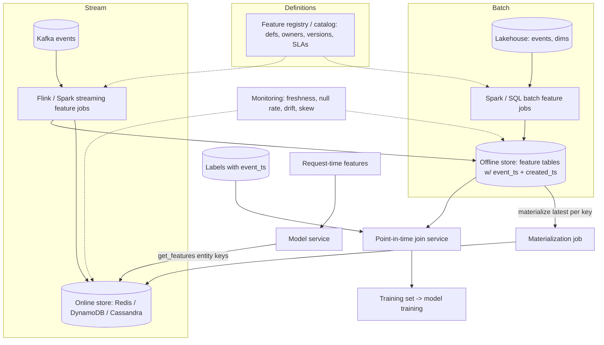

# Design 5: ML Feature Store (Offline + Online)

Prompt: "Design a feature platform that lets ML teams define features once, train on historical data with point-in-time correctness, and serve the same features online at under 10 ms."

## Requirements

Functional
- Feature definitions (entity, source, transformation, freshness) registered in a catalog and versioned.
- Offline: build training sets by joining features to labeled events as of each event time (no leakage).
- Online: low-latency lookup of the latest feature values by entity key for real-time models.
- Support batch features (daily aggregates), streaming features (last 5 min counts), and request-time features (computed in the request).
- Monitoring: freshness, drift, train/serve skew.

Non-functional
- Online p99 read under 10 ms at 20K QPS (each request fetches about 50 features across 3 entities).
- Online freshness: batch features within 1 h of computation; streaming features within seconds.
- Offline training sets: 100M labeled rows x 200 features generated in under an hour.
- Governance: ownership, PII tags, access control, lineage to models.
- Out of scope: model training/serving itself, embeddings/vector search (mention as extension).

## Capacity estimates

- Entities: 200M users, 5M items. Feature vector per user about 200 features x 8 bytes = 1.6 KB; 200M x 1.6 KB = 320 GB; with item features about 330 GB; Redis-like store with replication 2 = about 700 GB RAM, which is costly; DynamoDB/Cassandra-like store is cheaper on disk. Restrict online to active users (30-day active, say 40M -> 64 GB).
- Online read throughput: 20K QPS x 3 key lookups = 60K reads/s, easy for a sharded KV store.
- Streaming updates: 50K events/s -> feature updates at similar rates.
- Offline: feature history snapshots daily: 200M x 1.6 KB = 320 GB/day uncompressed; columnar and compression about 60-100 GB/day, 30-100 TB/year; use change-only storage (write only if value changed) or event-timestamped tables to reduce.

## Architecture

## Data model

Registry: `feature_view(name, version, entity, features[name,dtype], source, transform_ref, ttl, owner, tags[pii], schedule/trigger)`.

Offline table (per feature view): `entity_id, feature columns..., event_ts (when value became true), created_ts (when computed)`. Keep history rows; this is what makes point-in-time joins possible.

Online key: `{feature_view}:{entity_id}` -> map of features + `event_ts`; TTL per view. Alternatively one hash per entity with all views (fewer round trips, larger write amplification).

## Step-by-step flow

1. Author defines a feature view in code (for example Feast style, or an in-house SDK; check current docs of the tool you choose) with transformation SQL/Spark, entity, TTL, and freshness expectations. CI validates and registers.
2. Batch job computes features from silver tables for a date partition and writes to the offline store with `event_ts` = the time the value is valid from.
3. Streaming jobs compute windowed features (counts in last 5 min), writing to the online store directly and to offline via the same code path or a sink, so offline history exists for training.
4. Materialization: after each batch run, copy latest value per entity to the online store (bulk load, idempotent upserts, version stamp). Alert if lag exceeds SLA.
5. Training set: for each label row `(entity, label_ts)`, join the latest feature row with `event_ts <= label_ts` (and optionally `created_ts <= label_ts` to avoid using values computed later than known), using an as-of join. Output is snapshotted and versioned with the feature view versions, giving reproducible training data.
6. Serving: model service calls `get_online_features(keys, feature_list)`; a client library batches lookups, handles defaults for missing values, and logs the served feature vector to Kafka/lake.
7. Skew monitoring: compare logged served features to the offline recomputation for the same entity/time; alert on distribution drift.

## Failure modes

| Failure | Handling |
|---|---|
| Label leakage (using future data) | As-of joins only; tests that assert no feature has `event_ts > label_ts` |
| Train/serve skew (different code paths) | One definition feeding both; log served features and compare; avoid reimplementing in the service |
| Stale online features (job failed) | Freshness metric per view; TTL expiry to defaults; model falls back; page the owner |
| Online store hot key or node loss | Replication, client retries with hedged reads, key hashing, capacity headroom |
| Missing values for new entities | Defaults plus "is_missing" indicators; cold-start features |
| Backfill changes history | New feature version, never mutate old values; training sets pin versions |
| Cost blow-up in online store | Only materialize needed features for active entities; TTL |
| PII in features | Tag in registry, restrict access, hash/bucket, deletion hooks (design 8) |

## Trade-offs

- Build vs buy (Feast, Tecton, SageMaker/Vertex/Databricks feature stores, check current docs): buying speeds adoption; building fits unusual needs but needs a team.
- Redis (fastest, memory cost) vs DynamoDB/Cassandra (cheaper, single-digit ms): choose by latency budget and size.
- Streaming features give freshness but double the engineering; use only where lift justifies it.
- Store history for every feature (exact PIT) vs snapshots only (cheaper, coarser PIT). Daily snapshots cause up to 1-day leakage or staleness mismatches for fast-changing features.
- Precompute vs request-time compute: request-time features avoid staleness but add latency and skew risk.

## Follow-up questions

1. Explain a point-in-time join and implement it in SQL. (as-of join with `max(event_ts) <= label_ts`, or window function plus filter)
2. How do you detect training/serving skew? (log served vectors, compare distributions, replay the same request offline)
3. How do you add a new feature that needs 2 years of history? (backfill job to offline store with correct event_ts, then materialize)
4. How do you manage feature versions when a definition changes? (new version, parallel run, model pinned to version, deprecate)
5. How would you serve embeddings or very large features? (separate vector store; keep feature store for scalar/small vectors)
6. How do you control access to sensitive features? (tags, view-level ACLs, audit of reads)
