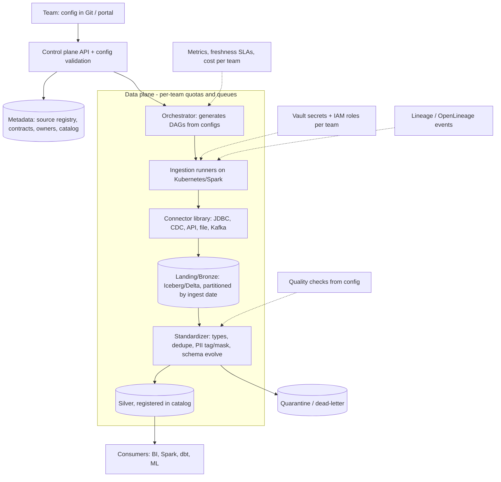

# Design 6: Self-Serve Data Lake Ingestion Platform for Many Heterogeneous Sources

Prompt: "We have 300 teams and 1,000 sources (databases, SaaS APIs, files, event streams). Build a platform where a team can onboard a source in under a day without a data engineer writing a custom pipeline."

## Requirements

Functional
- Declarative onboarding: a config (YAML/UI) describes source, connection, schedule or trigger, target table, PII columns, owner.
- Connectors: JDBC/CDC databases, REST/SaaS, SFTP/S3 files, Kafka topics.
- Output: raw (bronze) plus standardized silver tables in an open table format, registered in a catalog.
- Schema inference, evolution handling, quality checks, lineage, access control by default.
- Cost attribution and quotas per team.

Non-functional
- Scale: 1,000 pipelines, 50 TB/day total, 20,000 task runs per day.
- Onboarding time under a day; platform team of about 6 engineers (so reuse over custom).
- Isolation: one team's bad source cannot starve others (noisy neighbor).
- Reliability: at-least-once delivery with idempotent loads, automatic retry, clear ownership alerts.
- Security: least privilege, secrets in a vault, PII classified by default.
- Out of scope: custom business transformations (teams use a transformation layer on top).

## Capacity estimates

- 50 TB/day raw = 580 MB/s average. Bronze growth about 18 PB/year uncompressed; Parquet at 4-5x compression gives about 4 PB/year; apply lifecycle tiering and retention.
- 20K runs/day = 14 per minute average; control-plane load is small; scheduler needs to handle bursts at the top of the hour (use jitter).
- Metadata: 1,000 datasets x 100 columns, trivial; but lineage and quality events number in the millions per day.

## Architecture

## Data model

Source config (example fields): `source_id, owner_team, connector_type, connection_ref (vault path), extraction mode [full|incremental(cursor col)|cdc|append-files], schedule or trigger, target (db.schema.table), primary_key, partition_by, pii_columns, quality_rules, sla_freshness, retention`.

Metadata tables: `pipeline_run(run_id, source_id, status, rows_in, rows_out, bytes, started, ended, error_class)`, `schema_version(source_id, version, schema_json, compat_status)`, `contract(source_id, required_fields, types, owner_ack)`.

Bronze table columns: source payload columns plus `_ingest_ts, _run_id, _source_file/_offset, _op`.

## Step-by-step flow

1. Team submits a config via PR; CI validates schema, naming, connection reachability (test run), ownership, and PII declaration; reviewers for sensitive sources.
2. Control plane generates a DAG (or registers a dynamic task) per source, assigned to a queue/pool based on size tier and team quota.
3. Runner pulls credentials from the vault just in time, extracts with the connector (incremental cursor stored in metadata store, committed only after successful load), writes to Bronze with run metadata.
4. Standardizer infers/validates schema versus contract: additive changes auto-apply; breaking changes (drop/type change) stop the pipeline, quarantine data, and notify the owner with a diff.
5. PII columns are masked, hashed, or tokenized per policy; restricted columns get column-level access tags in the catalog.
6. Quality checks (not-null, uniqueness, freshness, volume anomalies) run; severity controls block vs warn.
7. Table published to the catalog with lineage; consumers discover it via search; access via request workflow.
8. Platform emits freshness and cost metrics; owners get alerts routed by team; a status page shows source health.

## Failure modes

| Failure | Handling |
|---|---|
| Source schema drift | Contract checks, auto-add nullable columns, block breaking changes, quarantine rows |
| Noisy neighbor (huge backfill) | Per-team quotas, pools/queues, resource limits, throttled concurrency, priority tiers |
| Source API rate limit or outage | Backoff with jitter, circuit breaker, resumable cursors, alerts only after retry budget |
| Duplicate loads on retry | Idempotent writes by run partition overwrite or MERGE on PK; cursor advances after commit |
| Credentials rotation breaks pipelines | Vault dynamic secrets, expiry alerts, canary checks |
| Misclassified PII | Automated scanners (regex/ML classifiers, check current docs for tools) plus owner attestations; default-deny on unclassified new columns |
| Orchestrator scaling (thousands of DAGs) | Generate DAGs sparingly, use dynamic task mapping or a config-driven single DAG per pattern, shard scheduler |
| Orphaned pipelines/costs | Ownership required; auto-flag unused tables; sunset workflow |

## Trade-offs

- Self-serve config vs code flexibility: configs cover about 80% of sources; provide an escape hatch (custom connector SDK) with review.
- Buy (Fivetran, Airbyte, managed ingestion; check current docs) vs build: buy the long tail of SaaS connectors; build the control plane, governance, and big-database paths where cost or control matters.
- Central platform vs data mesh: central ingestion with domain-owned silver/gold balances consistency and autonomy.
- Auto-evolve schemas vs strict contracts: strict is safer for gold consumers, auto is faster for onboarding; allow both by layer (auto in bronze, contracts in silver).
- Single multi-tenant cluster vs per-team clusters: shared saves cost, per-team isolates failures; use shared with quotas and a dedicated pool for heavy hitters.

## Follow-up questions

1. How do you onboard a CDC source versus a file source with the same config shape?
2. How do you prevent one team from reading another team's PII? (catalog ACLs, row/column policies, IAM boundaries, audit)
3. How do you measure platform success? (time to onboard, % pipelines on-time, incidents per 100 pipelines, cost per TB)
4. How do you upgrade connectors without breaking 1,000 pipelines? (versioned connectors, canary cohort, rollback)
5. How do you handle a source that sends 10x data after a launch? (autoscaling, volume anomaly alert, quotas, cost guard)
6. What would you automate next? (auto PII detection, auto-generated quality rules from profiles, self-healing retries)
