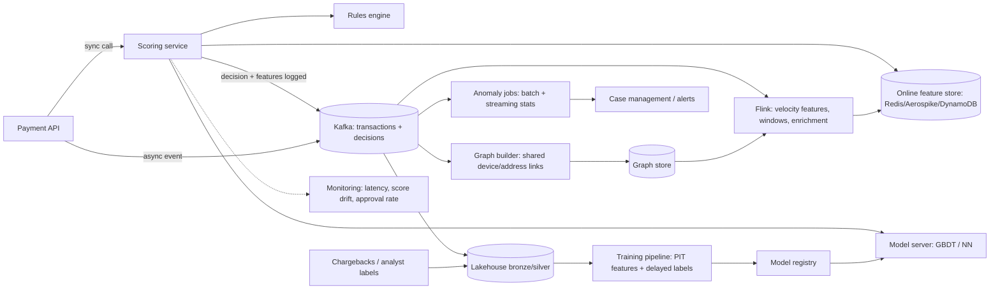

# Design 7: Real-Time Fraud / Anomaly Detection Pipeline

Prompt: "Design the data pipeline that scores every card/payment transaction for fraud in under 100 ms and also detects emerging fraud rings and anomalies over time."

## Requirements

Functional
- Score each transaction synchronously before approval (approve, step-up auth, decline) using rules plus an ML model.
- Compute behavioral features in real time (velocity: count and amount per card/device/IP/merchant over 1 min, 1 h, 24 h).
- Near-real-time graph/ring detection (shared devices, shared addresses) every few minutes.
- Feedback loop: chargebacks and analyst decisions become labels for retraining.
- Case management and audit of every decision.

Non-functional
- Decision latency: p99 under 100 ms for the scoring API (the entire pipeline budget, feature fetch under 20 ms).
- Availability: 99.99%; on failure, fall back to rules-only or a safe default (policy decision with the business).
- Throughput: 10K TPS average, 40K peak (peak shopping day).
- Precision/recall targets set with business (for example block less than 0.1% of good users).
- Compliance: PCI scope minimization (tokenized PANs), explainability for declines, retention.
- Out of scope: model research, card network integration.

## Capacity estimates

- 10K TPS x 86,400 = 860M transactions/day, 40K TPS peak.
- Event 1 KB: 40 MB/s peak into Kafka, about 860 GB/day raw; 7-day retention x 3 replicas approx 18 TB.
- Online state: 100M active cards/devices x 5 windows x 100 bytes = 50 GB; fits in a sharded in-memory store.
- Labels: fraud rate about 0.1% = 860K fraud transactions/day; chargebacks arrive 30-90 days later, so labels are delayed.
- Offline training data: 860M rows/day x 200 features; keep 12 months sampled (downsample non-fraud).

## Architecture

## Data model

- Event: `txn_id, card_token, device_id, ip, merchant_id, amount, currency, event_ts, channel, geo`.
- Decision log: `txn_id, model_version, rule_hits[], score, decision, feature_snapshot (exact vector served), latency_ms`.
- Online features: `key = card_token` -> `cnt_1m, cnt_1h, amt_24h, distinct_merchants_24h, last_geo, last_ts`; similar for device, IP, merchant. Updated by Flink; stored with TTL.
- Labels: `txn_id, label [fraud|legit|unknown], label_source, label_ts` (chargeback, analyst, customer dispute).
- Feature snapshots in the decision log are the key to leak-free training and for replay/debugging.

## Step-by-step flow

1. Payment API calls the scoring service with the transaction (tokenized card).
2. Scoring service fetches precomputed features from the online store (single multi-get), computes request-time features (amount vs user average, geo distance from last txn), runs rules, then the model. Rules handle hard blocks (sanctions, blocklists) and cheap catches; the model handles nuanced patterns.
3. Decision returned within budget; the full feature snapshot and decision are written to Kafka asynchronously (never on the critical path).
4. Flink consumes transaction events and updates velocity windows (sliding/tumbling with event time) and writes to the online store; the scoring service also adds the current txn to counters atomically (read-your-writes) or accepts a tiny lag.
5. Graph job links entities (card-device-address), computes connected components or risk propagation every few minutes, and writes ring/risk features back to the online store.
6. Labels arrive late; the training pipeline joins decision-time feature snapshots to labels with a label-maturity cutoff (for example only use transactions older than 60 days for "legit" labels), and handles selection bias (declined transactions have no label).
7. Retrain weekly/daily, evaluate offline and in shadow mode, canary then promote through the registry; monitor drift and approval rate.
8. Anomaly detection (statistical baselines per merchant, seasonality-aware) generates alerts into case management for analysts.

## Failure modes

| Failure | Handling |
|---|---|
| Online store slow or down | Strict timeout (for example 15 ms), fallback to rules-only plus conservative defaults, circuit breaker; replicate across AZs |
| Stale velocity features (Flink lag) | Lag alert; scoring includes feature timestamp, model tolerant; counters also updated synchronously by scoring service |
| Model server failure/bad model | Canary, automatic rollback, previous model warm, shadow evaluation |
| Label delay and bias | Maturity windows, reject inference for declined traffic, exploration traffic where allowed |
| Adversarial adaptation | Frequent retrain, rules for new patterns, ring detection |
| Feature skew between serving and training | Log served features; train on logged snapshots |
| Kafka lag affecting async feedback | Doesn't affect the sync path; alert and scale consumers |
| Cold start (new card/merchant) | Defaults, population-level priors, stricter rules for new entities |
| False-positive storm after deploy | Real-time approval-rate monitor, auto-rollback threshold |

## Trade-offs

- Sync scoring needs a tight latency budget: precompute features and keep the model small (GBDT) rather than heavy neural nets, or distill.
- Streaming features (seconds-fresh) vs batch features (hourly): velocity features must be streaming; long-term profile features can be batch.
- Rules vs ML: rules are explainable and instantly changeable; ML catches subtle patterns. Use both with a clear override hierarchy.
- Decline threshold: precision versus recall is a business cost curve (fraud loss vs lost sales vs customer friction); tune per segment.
- Graph features add power against rings but add pipeline complexity and latency (compute asynchronously, serve cached).
- Consistency: using eventually consistent counters risks allowing a burst of parallel fraud transactions within the lag window; mitigate with atomic increments on the hot path.

## Follow-up questions

1. How do you compute "transactions in last 10 minutes per card" at 40K TPS, correctly under retries? (keyed state or atomic counters with bucketed windows, dedupe by txn_id)
2. How do you train when labels arrive 60 days later? (maturity cutoff, label-delay-aware sampling, proxy labels such as analyst decisions)
3. How do you shadow-test a new model safely? (score in parallel, log, compare, no decision impact)
4. How do you explain a decline to a customer or regulator? (reason codes from rules, SHAP-style attribution on the model; store with decision)
5. How do you detect a model silently degrading? (score distribution drift, approval rate, chargeback rate by cohort, alert)
6. What changes for multi-region active-active? (regional feature stores, global entity linking tradeoffs, replication lag handling)
