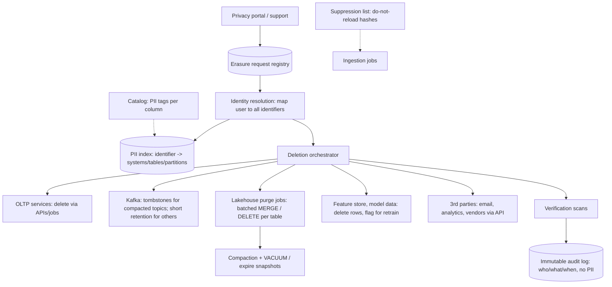

# Design 8: GDPR Deletion / Right to Erasure Across a Lakehouse

Prompt: "A user asks us to delete their personal data. Our data is in OLTP databases, Kafka, a lakehouse with bronze/silver/gold tables of petabytes, derived datasets, ML features, and backups. Design the deletion system."

This is a legal-adjacent topic. State assumptions and say "confirm with legal/privacy counsel" for retention exceptions and deadlines (GDPR generally requires action without undue delay and within one month, extendable in some cases; check current regulation and counsel).

## Requirements

Functional
- Accept deletion requests (from privacy portal/support), verify identity, create a tracked request.
- Delete or anonymize the subject's personal data in all systems of record and derived stores, or document the legal exemption (for example legal retention of invoices).
- Provide proof: audit trail showing what was deleted, where, when, by which job.
- Also support related rights: access/export, restriction, consent withdrawal (mention).

Non-functional
- SLA: complete within 30 days (internal target 14 days); request volume 5,000/day average, spikes after news events.
- Do not break analytics: aggregates and models remain valid; downstream consumers are notified.
- Safe: never delete the wrong person's data; idempotent; reversible window only before the execution step (deletions are irreversible, so use staged soft-delete first for a short grace period where legally acceptable).
- Efficient: do not rewrite petabytes per request, so batch requests.
- Out of scope: legal determination of what must be retained.

## Capacity estimates

- 5,000 requests/day; a lakehouse with 2,000 tables, of which 400 contain personal data identifiers; total 5 PB.
- Naive per-request delete rewrites every file containing that user's rows. If each request touched 400 tables x 1 file each of 256 MB, that's 100 GB rewrite per request x 5,000 = 500 TB/day: too expensive. Batching: accumulate requests for 24 h (or 7 days) and run one MERGE/DELETE per table with the whole set of ids. Cost becomes about one scan of the touched partitions per table per batch, so tens of TB per run for tables not clustered by user id; far less with data layout by user key or deletion vectors.
- Backups and retention windows: delete in backups by expiry (for example 35-day backup retention) rather than rewriting; document it.

## Architecture

## Data model

- `erasure_request(request_id, subject_ref, status [received|verified|planned|executing|verifying|completed|exempt], received_at, due_at, legal_hold_flag)`.
- `subject_identifiers(request_id, id_type [user_id, email_hash, device_id, ...], value_hash)`; resolve all identifiers a subject may appear under.
- `pii_inventory(system, table, column, id_type, tag, erasure_action [delete_row|nullify|pseudonymize|retain_with_exemption], owner)`; maintained from catalog column tags and verified by scanners.
- `erasure_task(request_id, system, table, status, rows_affected, snapshot_before/after, completed_at)`.
- `suppression_list(identifier_hash, added_at)`, a minimal record used to avoid re-ingestion of deleted subjects (store only a salted hash and document the legal basis).

## Step-by-step flow

1. Intake and verification: authenticate the requester, create the request, and set the due date.
2. Identity resolution: collect all identifiers (user id, emails, device ids, customer ids in partner systems) from the identity graph.
3. Planning: consult the PII inventory to enumerate every table/topic/store holding these identifiers; mark legal retention exceptions (for example finance records keep minimal fields and pseudonymize).
4. Staging: add identifiers to the day's deletion batch table; write to the suppression list.
5. Execute in OLTP: delete or anonymize via service APIs (source of truth first, otherwise CDC will re-propagate data).
6. Execute in lakehouse per table in batch:
   - `DELETE FROM silver.events WHERE user_id IN (SELECT user_id FROM erasure_batch)` or `MERGE` with delete; for pseudonymized datasets, delete the mapping key (crypto-shredding) to make the data unlinkable.
   - Table formats with copy-on-write rewrite files immediately; with merge-on-read/deletion vectors the data persists in old files until compaction and snapshot expiry, so you must run compaction and expire snapshots/VACUUM within the SLA (details vary by Delta/Iceberg/Hudi and version, check current docs).
   - Bronze raw data often keeps original payloads: delete there too, or never store raw PII in bronze (tokenize at ingest).
7. Kafka: topics with short retention expire naturally within the SLA; compacted topics receive tombstones; long-retention topics are avoided for PII or use field-level encryption.
8. Derived stores: feature store, search indices, caches, BI extracts, notebooks, reports; delete or rebuild; ML training sets and models: flag for next retrain; document the policy (many teams accept that already trained model weights are not retrained per request, but this is a legal question).
9. Verification: scan for the identifiers across tables (using hashed lookup or the PII index); sample-based search of unstructured storage; anything remaining raises an exception.
10. Backups: rely on expiry; any restore from backup must re-apply the erasure log before use ("replay deletions after restore").
11. Close: write an immutable audit record (without PII), confirm to the user.

## Failure modes

| Failure | Handling |
|---|---|
| PII in unknown places (ad hoc copies, notebooks) | Catalog scanning and tagging, ban on uncontrolled copies, retention on sandboxes |
| Deleting the wrong subject (identity collision) | Strong verification, exact-match identifiers, dry-run counts, staged soft delete for a grace window |
| Data reappears from replay/backfill/restore | Suppression list at ingestion and restore procedures that re-apply the erasure log |
| Deleted logically but files still physically present | Compaction + snapshot expiry/VACUUM in SLA; verify at storage level |
| Job partial failure | Per-table idempotent tasks, retries, status tracking, alert on overdue requests |
| Expensive full-table scans | Batch requests; cluster/sort by user key; deletion vectors; partition by something useful; PII index to prune files |
| Downstream breakage (FK, aggregates) | Replace with pseudonymous tombstone ids; aggregates retained when irreversibly anonymous |
| Third-party processors not deleting | Contracts, API-based deletion, confirmation tracking |
| Legal hold conflicts | Registry flag blocks deletion; privacy team resolves |

## Trade-offs

- Hard delete vs pseudonymize vs crypto-shredding: hard deletes are certain but expensive; crypto-shredding (per-user key deleted so all copies become unreadable) is fast across backups and bronze but requires key management and encryption-at-write design from the start. Legal acceptance varies (check with counsel).
- Batching windows: longer windows save cost but approach the deadline; choose 1-7 days with a priority path.
- Design for deletion up front: store PII in a few tokenized tables (a "PII vault") and use surrogate keys elsewhere; erasure then deletes one place, and analytics stay pseudonymous.
- Table format differences: copy-on-write simplifies physical deletion; merge-on-read is cheaper to write but needs extra purge steps.
- Retention as erasure: short retention on raw/bronze reduces the surface area.

## Follow-up questions

1. How do you delete from immutable Parquet files in a table format? (rewrite files without the rows, new snapshot, expire old snapshots/VACUUM so old files are removed)
2. What about time travel? (expiring snapshots removes old versions; set retention shorter than SLA for PII tables)
3. How do you avoid rewriting petabytes per request? (batching, clustering by user key, PII vault + surrogate keys, deletion vectors plus compaction)
4. How do you handle ML models trained on deleted data? (policy decision; retrain cadence; machine unlearning is research-level, check current guidance)
5. How do you prove deletion to a regulator? (immutable audit trail, verification scans, evidence of table snapshot versions)
6. How would you design the ingestion path so erasure is cheap from day one? (tokenize at the edge, field-level encryption with per-subject keys, PII tagging in contracts)
