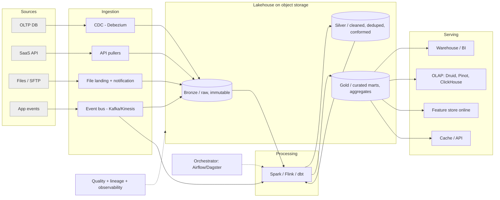

# Week 7: Data Pipeline and Platform Design Framework

Senior data engineer design rounds are not "draw Kafka -> Spark -> warehouse". They test whether you can turn vague business needs into a platform with explicit freshness, correctness, cost, and operability guarantees. Use one skeleton for every prompt, then go deep where the interviewer pushes.

Companion files: [interview-qa.md](interview-qa.md), [cheatsheet.md](cheatsheet.md), [../mock-interview.md](../mock-interview.md), and the eight worked designs in [designs/](designs/).

## 1. 45-minute time split

| Min | Phase | Output on the board |
|---|---|---|
| 0-7 | 1. Clarify requirements | Sources, volume, freshness SLA, consumers, correctness bar, compliance, out-of-scope |
| 7-12 | 2. Estimate | events/s avg and peak, GB/day, TB/year, cost order of magnitude |
| 12-25 | 3. Architecture | Ingest -> storage layers -> processing -> serving, one record walked end to end |
| 25-40 | 4. Deep dives | 2-3 hard parts: late data, exactly-once, backfill, schema evolution, skew |
| 40-45 | 5. Ops and evolution | Quality, observability, failure modes, cost levers, what changes at 10x |

## 2. Step 1: clarify requirements

Ask these, in this order. Write the answers down; they drive every later choice.

| Question | Why it matters |
|---|---|
| Who consumes the output and how (dashboard, ML model, API, finance close, regulator)? | Defines serving layer and SLA |
| Freshness: how stale may data be (seconds, minutes, hours, next day)? | Batch vs streaming; cost multiplier of 5-10x for streaming |
| Volume: rows/day, events/s, row size, growth rate? | Sizing, partitioning, file layout |
| Velocity and shape: bursty? seasonal? skewed keys? | Autoscaling, hot partitions |
| Correctness: can we lose, duplicate, or reorder? Must totals tie to a source of truth? | Delivery semantics, reconciliation |
| Source types: OLTP DB, SaaS API, files, event bus, third party? Who owns them? | Ingestion pattern, contracts |
| History: backfill needs, retention, reprocessing frequency? | Immutable raw layer, replayability |
| Compliance: PII, GDPR/CCPA, SOX, residency, audit? | Encryption, masking, deletion, lineage |
| Budget and team: cloud, existing stack, headcount? | Managed vs self-run |

State out loud: "The hardest requirement here seems to be X (for example: 5-second freshness, or penny-exact reconciliation)." That frames the whole answer.

## 3. Step 2: batch vs micro-batch vs streaming

| Mode | Typical latency | Best for | Cost and complexity |
|---|---|---|---|
| Batch (hourly/daily) | minutes to hours | Finance, reporting, big historical recompute | Lowest; easy to re-run |
| Micro-batch (Spark Structured Streaming triggers, 1-15 min) | 10 s to minutes | Near-real-time analytics, CDC merges into lakehouse | Medium |
| True streaming (Flink, Kafka Streams) | sub-second to seconds | Fraud, alerting, live ops metrics, per-event enrichment | Highest: state, watermarks, exactly-once, on-call |

Decision rule: pick the slowest mode that meets the freshness SLA. Many designs are hybrid: streaming for the hot path (approximate, fast), batch for the correct path (authoritative, re-runnable). Two shapes of hybrid to name:

- Lambda: separate batch and speed layers merged at query time. Two codebases; drift risk.
- Kappa / unified: one streaming codebase, replay from the log for reprocessing. Requires long retention or a lakehouse as replay source. Modern engines (Spark, Flink) can run the same logic in batch and streaming mode, which reduces Lambda's duplication.

## 4. Reference architecture

## 5. Step 3: ingestion patterns

| Source | Pattern | Key concerns |
|---|---|---|
| OLTP database | Log-based CDC (Debezium on MySQL binlog / Postgres WAL) into Kafka, or managed (check current docs for DMS, Datastream, Fivetran) | Initial snapshot + stream handoff, ordering per key, deletes, schema changes, replication slot growth |
| OLTP, no log access | Incremental query on `updated_at` or high-watermark ID | Misses hard deletes; clock skew; late commits (use overlap window) |
| SaaS API | Scheduled pullers with cursors, rate-limit backoff | Pagination, idempotent loads, API schema drift, quotas |
| Files (SFTP, S3 drops) | Landing zone + manifest/notification, checksum, quarantine bad files | Partial uploads, duplicates, naming conventions, late arrivals |
| Events | Producer SDK -> Kafka/Kinesis/PubSub -> sink connector | Schema registry, partition key choice, event time vs ingest time, PII at the edge |

Always land raw data unchanged first (bronze) with metadata: source, ingest time, batch id, source offset/LSN. This makes every downstream step replayable.

## 6. Step 4: storage layers (medallion)

| Layer | Contents | Rules |
|---|---|---|
| Bronze / raw | As-received, append-only, original format or lightly parsed | Never mutate; retain for replay; partition by ingest date |
| Silver / cleaned | Deduped, typed, conformed keys, PII tagged, SCD history | Idempotent merges (upsert by key); quality checks gate promotion |
| Gold / curated | Business marts, star schemas, aggregates, metric definitions | Optimized for query; documented owners; semantic layer |

Format: open table formats (Iceberg, Delta, Hudi) give ACID commits, schema evolution, time travel, and row-level MERGE/DELETE on object storage. Details vary by engine and version (check current docs). Partition by a low-cardinality column used in filters (usually date); avoid over-partitioning (small files). Compact small files regularly.

## 7. Step 5: processing

- Batch transforms: Spark, dbt on a warehouse, SQL engines. Make every job idempotent: output = f(inputs for a partition), written with overwrite-partition or MERGE, never blind append.
- Streaming: choose event-time semantics with watermarks for lateness, state with checkpoints, and a sink that is idempotent or transactional for end-to-end exactly-once effect.
- Deduplication: natural key + version (LSN, `updated_at`, sequence number) with ROW_NUMBER latest-wins, not "last arrived wins".
- Data skew: salt hot keys, broadcast small tables, rely on adaptive query execution in Spark 3.x (check current docs for defaults).

## 8. Step 6: serving

| Need | Choice | Notes |
|---|---|---|
| Ad hoc SQL, BI, finance | Warehouse / lakehouse SQL engine (Snowflake, BigQuery, Redshift, Databricks SQL, Trino) | Best flexibility; seconds latency; concurrency cost |
| User-facing, sub-second, high-concurrency aggregates | OLAP store: Druid, Pinot, ClickHouse | Pre-aggregation/rollups, limited joins, strong on time-series filters |
| ML | Feature store: offline (lake) + online (Redis, DynamoDB, Cassandra) | Point-in-time correctness, train/serve skew |
| Operational lookups | Key-value / cache in front of gold | TTLs, invalidation |
| Reverse ETL | Push gold to SaaS tools | Idempotency, rate limits |

## 9. Orchestration, quality, observability

Orchestration (Airflow, Dagster, Prefect, or cloud-native): DAGs with explicit dependencies, retries with backoff, idempotent tasks, backfill by date range, SLAs, sensors for data arrival (prefer data-aware/asset-based triggering over fixed clock times), concurrency pools.

Data quality at each layer boundary:

| Check | Example | On failure |
|---|---|---|
| Schema | column present, types | Block, alert producer |
| Freshness | max(event_ts) within SLA | Alert; mark dataset stale |
| Volume | row count within +-X% of trend | Quarantine batch |
| Uniqueness / null | PK unique, required not null | Dead-letter bad rows, fail if above threshold |
| Referential | FK exists in dimension | Late-arriving dimension handling |
| Reconciliation | sum(target) == sum(source) | Hard block for finance |
| Distribution | metric drift | Warn |

Tools: Great Expectations, dbt tests, Soda, Deequ (check current docs). Use a block vs warn policy so non-critical checks do not stop pipelines.

Observability: the three pillars for data are freshness, volume, and schema, plus lineage (OpenLineage) and job metrics (duration, bytes, retries, consumer lag, watermark delay). Alert on symptoms consumers feel (stale table), not only on task failures. Every dataset has an owner and a runbook.

## 10. Backfill and reprocessing

- Keep bronze immutable and replayable; keep the Kafka offsets/LSN you loaded.
- Make jobs parameterized by partition so backfill = re-run for date range, overwrite partitions.
- Run backfills in an isolated cluster/queue with throttled concurrency so they do not starve production.
- With table formats, write the backfill to a new branch/snapshot or shadow table, validate, then swap (or MERGE) in.
- Downstream impact: notify consumers; late corrections to aggregates need restatement policy (what changes in published reports).

## 11. Failure modes to name

| Failure | Mitigation |
|---|---|
| Duplicate delivery (at-least-once) | Idempotent sinks, dedupe on key+version |
| Out-of-order / late events | Event time, watermarks, allowed lateness, correction path in batch |
| Upstream schema change | Schema registry, compatibility rules, contract tests, tolerate additive changes |
| Poison message | Dead-letter queue with reason, replay tool |
| Source outage / backlog | Bounded retries, backpressure, catch-up capacity headroom |
| Small-file explosion | Compaction, larger triggers |
| Skew / hot partition | Salting, key redesign, AQE |
| Partial failure in multi-table write | Atomic commits per table, publish via pointer/view swap |
| Silent data corruption | Reconciliation, distribution checks, time travel to roll back |
| Cost runaway | Budgets, query guardrails, auto-termination, lifecycle policies |

## 12. Cost, security, and evolution

Cost levers: pick batch over streaming where allowed; columnar formats (Parquet) with compression and pruning; partition and cluster for scan reduction; tiered storage with lifecycle rules; spot/preemptible workers for batch; right-size retention of raw; materialize hot aggregates instead of rescanning; separate compute per workload.

Security and governance: encryption at rest and in transit; least-privilege IAM per layer; column/row-level security and masking for PII; tokenization or hashing at ingest; audit logs; data catalog with classification tags; retention policies; deletion workflow (see [design 8](designs/08-gdpr-erasure.md)).

Evolve over time: start with batch + one warehouse; add streaming only for the use cases that justify it; introduce a catalog and contracts as sources multiply; add a semantic layer when metric definitions diverge; adopt data mesh style domain ownership when a central team becomes the bottleneck (state tradeoffs: governance consistency vs autonomy).

## 13. What to say out loud (checklist)

1. "Let me clarify freshness, correctness, and who consumes this."
2. "I will pick the slowest processing mode that meets the SLA, because streaming costs more to run and operate."
3. "Raw is immutable so I can always replay."
4. "Every stage is idempotent, so retries and backfills are safe."
5. "Quality gates sit between layers; here is what blocks and what warns."
6. "Here is how I detect and recover when this breaks at 3 a.m."
7. "At 10x I would change X, and cost drivers are Y."

## 14. The eight designs

| # | Design | Core difficulty |
|---|---|---|
| 1 | [Clickstream analytics](designs/01-clickstream-analytics.md) | Volume, sessionization, late events |
| 2 | [CDC to lakehouse](designs/02-cdc-to-lakehouse.md) | Ordering, deletes, snapshot handoff |
| 3 | [Real-time metrics dashboard](designs/03-realtime-metrics-dashboard.md) | Low-latency aggregation, serving |
| 4 | [Daily finance ETL](designs/04-finance-batch-etl.md) | Reconciliation, auditability |
| 5 | [Feature store](designs/05-feature-store.md) | Point-in-time correctness, skew |
| 6 | [Self-serve ingestion platform](designs/06-self-serve-ingestion-platform.md) | Multi-tenancy, schema drift, governance |
| 7 | [Real-time fraud detection](designs/07-fraud-detection.md) | Latency, state, feedback loops |
| 8 | [GDPR erasure on a lakehouse](designs/08-gdpr-erasure.md) | Deleting from immutable files and backups |
